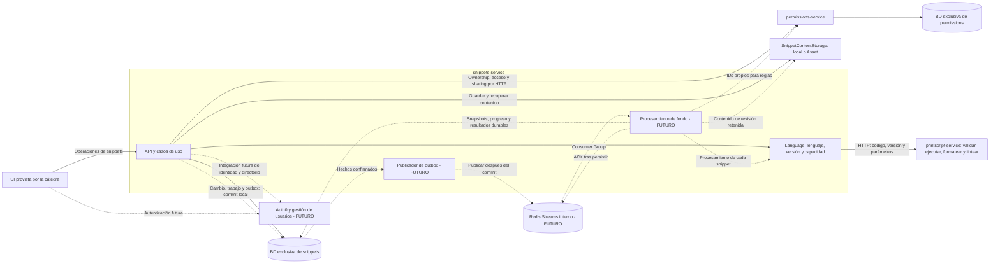

# Arquitectura y flujos de Snippet Searcher

Diagramas editables en Mermaid, basados en la consigna, las US1–16 y las decisiones del equipo. Describen el diseño propuesto; no afirman que estos componentes ya estén integrados en el Compose actual.

[ADR-001 / SNI-27](adr-001-async-processing.md): arquitectura híbrida aprobada el
29/10/2026. HTTP síncrono por defecto y eventos con Redis Streams + outbox para los
tres casos acordados. [Diseño mínimo](async-processing-design.md): contratos,
recuperación y trabajo posterior. Implementación asíncrona pendiente.

## Cómo leerlos

- **Acordado:** snippets coordina los casos de uso; permissions posee ownership y sharing; Language es interno de snippets y delega por HTTP al servicio del lenguaje.
- **Aprobado, pendiente de implementar:** Redis Streams, Consumer Groups y outbox para US12/15, revalidación por activación administrativa de parser y US16. PostgreSQL conserva trabajos, progreso y resultados.
- **Estado por componente:** Auth0 y US11–16 siguen separados. Storage local y adaptador Asset ya existen; seleccionar Asset en Azure es otra operación. US8–10 tiene motor/cliente integrado y entregas de coordinación/UI con estado propio en SNI-48/49/51/53; los diagramas no certifican aceptación conjunta.
- **Diseño de reglas:** owner + lenguaje + versión, original como revisión del usuario y formateado como derivado. Concretar contratos funcionales en la implementación; PrintScript mantiene capacidades HTTP y carece de BD de negocio propia.

Los perfiles de las User Stories no son roles de autorización. Ningún servicio accede a la base de otro.

## Componentes

PrintScript recibe código y parámetros; no posee snippets ni consume Redis. El
estado transitorio del intérprete se distingue de la persistencia de trabajos y
resultados en Snippets. SNI-48 tiene auditoría durable interna aprobada y entrega
en revisión al consultar Linear el 29/10; verificar integración antes de reutilizarla.

## Flujos principales

Para US8–10, consultar el [contrato de ejecución incremental
(SNI-45)](./execution-contract.md) y sus [fixtures](../contracts/execution-v1.json).
Documenta las decisiones aprobadas por Thiago y sus trade-offs; no afirma
que existan los endpoints ni que la ejecución integrada esté implementada.

| Flujo | Fuente | Diagrama |
| --- | --- | --- |
| Crear y actualizar, por archivo o editor | US1–4 | [Creación y actualización](./flows/create-update-snippet.md) |
| Listar, visualizar y descargar | US5–6, US13 | [Consultas y descargas](./flows/read-snippets.md) |
| Compartir y resolver acceso | US7 | [Sharing y permisos](./flows/sharing-permissions.md) |
| Crear tests, ejecutarlos y correrlos tras un update | US8–9, US16 | [Tests](./flows/tests.md) |
| Pedir inputs y mostrar outputs durante la ejecución | US10 | [Ejecución interactiva](./flows/interactive-execution.md) |
| Configurar reglas y generar formateado | US11–12, US13 | [Formatting](./flows/formatting.md) |
| Configurar reglas y evaluar cumplimiento | US14–15, US5–6 | [Linting](./flows/linting.md) |
| Revalidar al cambiar el parser | Consigna general | [Revalidación del parser](./flows/parser-revalidation.md) |

## Recordatorios

- Parser inválido impide guardar; incumplir lint es un resultado; un test fallido nunca revierte el update.
- HTTP síncrono para operaciones puntuales. US12/15, activación de parser y US16 usan el diseño aprobado de eventos + Redis Streams + outbox; su implementación sigue pendiente.
- US9/10 necesitan salida incremental; la sesión interactiva además recibe inputs durante la ejecución.
- Conservar original y formateado. Asociar resultados a revisión de código, reglas y procesador; no publicar resultados obsoletos como actuales.
- El contrato con la UI para US1–7 está en [ui-integration.md de Snippets](https://github.com/JJT-INGSIS/snippets-service/blob/dev/docs/ui-integration.md) (SNI-26).
- Antes de implementar, concretar contratos de UI/reglas, retención de revisiones, identidad del procesador y capacidad compartida; reutilizar la abstracción de storage existente.

Para actualizar un diagrama, editar su bloque `mermaid`. Los enlaces entre archivos son relativos; desde Google Docs se utilizan enlaces absolutos de GitHub a estos mismos archivos.
