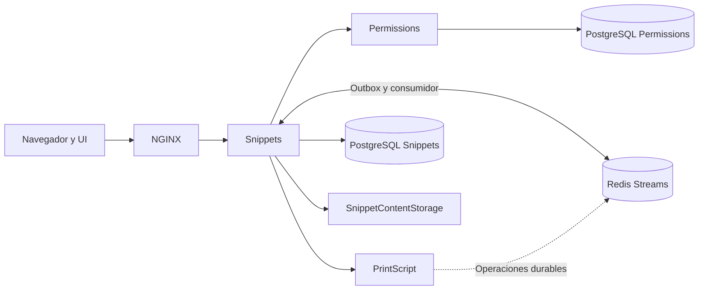

# Arquitectura y flujos de Snippet Searcher

El navegador usa la UI y consume Snippets por `/api/` en NGINX. Snippets autoriza
las operaciones y coordina el contenido y sus metadatos. Permissions guarda
ownership y accesos compartidos en su propia base. PrintScript expone por HTTP
validación, ejecución, formato y lint. `Language` es un módulo interno de
Snippets que adapta esos contratos. [Identidad y límites de acceso](authentication-authorization-contract.md).

El diagrama muestra las dependencias disponibles. Redis y el proveedor de storage
se determinan por la configuración efectiva del ambiente. Los servicios
interactúan por HTTP para pedidos puntuales. Los lotes asíncronos se apoyan en un
outbox transaccional y Redis Streams. [Decisión de arquitectura](adr-001-async-processing.md) ·
[Procesamiento asíncrono](async-processing-design.md).

## Flujos principales

| Flujo | Historias | Diagrama |
| --- | --- | --- |
| Crear y actualizar por archivo o editor | US1–4 | [Creación y actualización](flows/create-update-snippet.md) |
| Listar, visualizar y descargar | US5–6, US13 | [Consultas y descargas](flows/read-snippets.md) |
| Compartir y resolver acceso | US7 | [Sharing y permisos](flows/sharing-permissions.md) |
| Crear tests, ejecutarlos y correrlos tras un update | US8–9, US16 | [Tests](flows/tests.md) |
| Recibir resultados e ingresar valores durante la ejecución | US10 | [Ejecución interactiva](flows/interactive-execution.md) |
| Configurar formato y crear variantes | US11–13 | [Formatting](flows/formatting.md) |
| Configurar lint y evaluar cumplimiento | US14–15 | [Linting](flows/linting.md) |
| Revalidar al activar una revisión del parser | Consigna | [Revalidación](flows/parser-revalidation.md) |

[Contrato de ejecución incremental](execution-contract.md) ·
[Operación y ambientes](../operations.md) · [Observabilidad](../observability/README.md).
