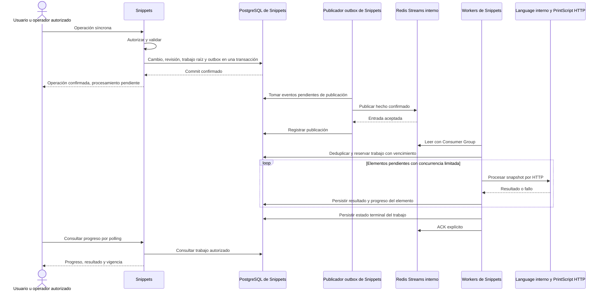

# Procesamiento asíncrono — diseño mínimo de SNI-27

Complementa la [ADR-001](adr-001-async-processing.md), aprobada por Juan Francisco
Siaba el 29/10/2026. Es diseño para implementación posterior: no acredita Redis,
workers, outbox ni nuevos endpoints instalados. Los nombres siguientes son lógicos;
el DDL y la configuración concreta pertenecen a los tickets de implementación.

## Recorrido y responsabilidades

Snippets es productor y coordinador. Publicador y handlers se ejecutan dentro de
la aplicación existente, con recursos acotados y ciclos de vida explícitos. No hay
un nuevo microservicio por evento. Language adapta HTTP; PrintScript no consume
Redis. Un lote puede terminar con errores parciales: cada elemento tiene progreso
persistido y no obliga a volver a procesar los ya completados.

## Hechos y esquema de eventos

Sobre común versión 1:

| Campo | Significado |
| --- | --- |
| `eventId` | UUID generado una vez por hecho; se conserva al republicar |
| `eventType` | Uno de los cuatro tipos acordados |
| `schemaVersion` | Entero de versión del esquema; inicialmente 1 |
| `occurredAt` | Fecha UTC del hecho, serializada como RFC 3339; no determina orden |
| `aggregateId` | Identificador estable del snippet, configuración o activación |
| `aggregateRevision` | Revisión persistida de ese agregado; no es la versión de lenguaje |
| `correlationId` | Identificador para relacionar operación, evento y trabajos |
| `data` | Identificadores, ámbito y revisiones específicos del hecho |

| Evento | Datos específicos mínimos | Reacción actual |
| --- | --- | --- |
| `FormattingRulesChanged` | ID/revisión de configuración, owner estable, lenguaje y versión | US12: generar derivados formateados de snippets afectados |
| `LintRulesChanged` | ID/revisión de configuración, owner estable, lenguaje y versión | US15: evaluar cumplimiento y diagnósticos |
| `ParserVersionActivated` | ID de activación, lenguaje/versiones afectadas, identidad verificable del parser/procesador activado | Revalidar snippets de ese ámbito, de todos los owners |
| `SnippetUpdated` | ID/revisión de snippet, lenguaje, versión y referencia al snapshot durable del cambio | US16: ejecutar los tests seleccionados para esa revisión |

Los eventos expresan hechos ya confirmados. No se emiten antes de validar o sobre
un rollback. No transportan comandos de PrintScript, tokens, headers de identidad
ni código fuente. Los datos voluminosos se recuperan de PostgreSQL/storage mediante
referencias retenidas. El contexto de iniciador se conserva en el registro durable
para auditoría; no concede autoridad por sí solo.

Cada update confirmado genera su propio hecho. Deduplicar reentregas del mismo
evento no convierte el PUT público en idempotente ni une dos updates distintos.
`SnippetUpdated` no dispara lint, formato ni otras reacciones fuera de US16.

Inicialmente: un stream por ambiente, un grupo para estas reacciones y un handler
por tipo. Instancias del mismo grupo compiten por entregas; no reciben cada una
una copia del evento. Una reacción funcional independiente futura requiere su
propio grupo y su propia deduplicación. Al crear el grupo se consume desde el
inicio del historial retenido; no se salta trabajo pendiente usando sólo lo nuevo.

## PostgreSQL, transacciones y outbox

Tres estructuras lógicas, con migraciones posteriores:

| Registro | Información mínima |
| --- | --- |
| Outbox | Sobre/payload inmutable, evento, trabajo asociado, publicación e intentos, próximo intento y último error acotado |
| Trabajo | ID, evento/reacción únicos, ámbito, revisión/snapshot, iniciador/correlación, estado, progreso de selección, reserva temporal, fechas y error |
| Elemento y resultado | Trabajo + snippet/revisión o test/snapshot únicos, estado, intentos, próximo intento, resultado/diagnósticos y vigencia |

Se reutilizarán registros de resultados y auditoría existentes cuando representen
la misma capacidad; no se duplican fuentes de verdad ni se construye un framework
genérico. La deduplicación se apoya en unicidad de `(eventId, reacción)` y de cada
elemento lógico; se actualizan resultado y progreso en una transacción corta.

El cambio principal, su revisión, el trabajo raíz y el evento outbox se insertan
en el mismo commit local. La publicación sucede después, mediante lectura
periódica del outbox. Un fallo de Redis deja publicación pendiente; un fallo de
inserción del outbox revierte el cambio local. Un backlog o disco agotado exige
diagnóstico y capacidad operativa; no se confirma un cambio perdiendo su evento.

La actualización actual usa `JdbcSnippetContentLinks.replaceContent` y
`MetadataTransaction.commit`, con propagación `REQUIRES_NEW`. Agregar un outbox
después de ese commit o envolver el caso de uso con otra transacción no garantiza
atomicidad. La futura unidad de escritura debe incluir revisión, snapshot/trabajo
y outbox en la transacción que efectivamente reemplaza metadata/referencia,
manteniendo la intención del caso de uso explícita, sin listeners ocultos.

Storage se escribe antes de vincular el blob nuevo; Permissions se consulta en su
frontera actual. Ninguno entra en una transacción distribuida. Se preservan creación
PENDING/CONFIRMED, clave de idempotencia, ownership previo a confirmar creación y
reglas actuales sobre escritura incierta. No se genera `SnippetUpdated` por crear
ni se elimina contenido nuevo cuando un commit pudo haberlo referenciado.

El publicador marca publicación sólo tras recibir confirmación de Redis. Si cae
después de publicar y antes de guardar esa marca, repite el mismo evento. El ID de
entrada Redis identifica una entrega y es distinto de `eventId` y `jobId`. Las
reservas del publicador/worker son cortas y no mantienen locks de BD durante HTTP.

## ACK, recuperación y reintentos

- Entrega at-least-once; procesamiento idempotente de efectos persistidos, sin prometer exactamente una ejecución del intérprete.
- Inicialmente el mensaje permanece pendiente hasta que el trabajo tenga estado terminal persistido: completado, completado con errores, fallido definitivo o superado. Reentregas de un terminal sólo verifican el registro y hacen ACK.
- Los workers reanudan desde elementos pendientes; no repiten resultados ya confirmados. `XACK` ocurre después del commit. No se usa `receiveAutoAck`.
- Recuperar entradas pendientes con `XPENDING`/`XAUTOCLAIM`. La reserva temporal del trabajo en PostgreSQL, renovable y con un token de posesión verificado al guardar, evita que un consumidor viejo publique resultados tras perder el trabajo. Reclamar una entrada Redis no acredita que el worker anterior haya terminado.
- Un trabajo largo cede ejecución entre lotes acotados; la consulta de pendientes respeta el próximo intento y reserva de BD. Ningún handler mantiene ocupado indefinidamente el único turno por un lote completo.
- Fallos transitorios de red/dependencias/capacidad usan espera creciente, variación y número de intentos configurables. Fallos definitivos de datos o capacidad no soportada quedan registrados. Cada elemento puede fallar sin impedir completar los demás. No hay bucles de reintento sin espera.
- Un programa inválido, un incumplimiento de lint y un test FAILED son resultados de negocio, no fallas de transporte para reintentar indefinidamente.
- Un mensaje mal formado o de esquema no admitido queda registrado en PostgreSQL con entrega, motivo y datos acotados para diagnóstico; luego se confirma su apartamiento. No se agrega otro stream de errores inicialmente. Un operador puede corregir la causa y autorizar recuperación explícita.
- Si falla la persistencia, no hay ACK. La reentrega recupera desde el último avance confirmado.

Un estado que requiere reconciliación conserva motivo, intento e identidad remota
conocida. En US16, un POST de inicio incierto no se repite automáticamente. Si hay
ID PrintScript, usar estado/replay y las capacidades acordadas en SNI-48; si no hay
prueba suficiente, conservar UNKNOWN y la reserva necesaria hasta aclarar el intento.
Nunca liberar cupo por un timeout local ni presentar incertidumbre como assertion
fallida. El mensaje sólo puede confirmarse en ese caso después de persistir también
la obligación recuperable de reconciliación; el recuperador debe retomarla desde
PostgreSQL. Un segundo consumidor no puede iniciar otro programa para ese intento.

La marca de publicación no sustituye la confirmación de trabajo. Retener outbox y
snapshots de trabajos incompletos permite republicar el mismo evento al reconstruir
Redis, incluso si se perdió una publicación ya marcada. La reconciliación consulta
trabajos no terminales y respeta reservas/intentos antes de reenviar. Eliminar outbox
o recortar streams requiere comprobar entrega/progreso de todos los grupos activos;
un `MAXLEN` ciego no puede descartar trabajo aún necesario. Las ventanas de retención
y la limpieza de terminales se fijarán y probarán antes de activar el sistema.

## Snapshots, selección y vigencia

Identificar por separado revisión de contenido, configuración de reglas, definición
del test y procesador. Reutilizar `codeHash` y `testHash` de SNI-45, sin normalizar
strings; un hash identifica pero no reconstruye el contenido. No se usa el UUID de
snippet ni la versión de lenguaje como sustituto de revisión de código/procesador.

- **Reglas:** ámbito inicial owner + lenguaje + versión, sobre snippets propios. La selección se pagina y guarda un cursor/avance estable y elementos únicos, con comprobación de ámbito vigente. El inicio del lote fija una frontera de revisiones; ediciones posteriores se identifican como tales. Si cambia la configuración, el lote viejo queda superado y el evento nuevo cubre la evaluación vigente. Las semánticas de creación/edición individual y derivados se concretan con US11–15, manteniendo su procesamiento síncrono.
- **Parser:** activación administrativa explícita, autorizada y auditable en Snippets, después de comprobar qué revisión está disponible. Persistir activación + trabajo + outbox. El deploy no activa ni dispara por sí solo. Revalidar todos los owners del ámbito sin inventar un usuario global; conservar snippets ahora inválidos y sus diagnósticos, sin migrar su versión declarada de lenguaje.
- **US16:** una ejecución automática por cada revisión de update confirmada, con copia durable del conjunto/definiciones de tests seleccionados y referencia retenida al código de esa revisión. Un conjunto vacío completa sin invocar PrintScript. Ediciones posteriores no cambian ese snapshot; los resultados anteriores quedan históricos y no se presentan como actuales.

Actualmente el update puede eliminar el blob anterior; una referencia en el evento
no basta para recuperarlo después. La implementación deberá retener el blob inmutable
mientras haya trabajo que lo necesita y coordinar su liberación con las transacciones
de reemplazo. No se duplica el código como otra fuente autoritativa. Se reutiliza la
auditoría/snapshots de SNI-48 cuando corresponda; la política de retención debe cubrir
también trabajos todavía no iniciados, no sólo sesiones ya abiertas.

Los resultados se publican como vigentes mediante comprobación atómica de las
revisiones relevantes. Un resultado superado puede conservarse para auditoría, pero
no sobrescribe al actual. Si no puede comprobarse vigencia, se declara desconocida.
Para formato, se almacena un derivado separado del original y sólo se publica su
referencia si sigue correspondiendo; se conserva el tratamiento seguro de blobs
ante escrituras inciertas.

Identificar de forma verificable el procesador es una capacidad pendiente. SNI-48
registra por ahora lenguaje y snapshots, sin revisión binaria en el descriptor.
Se necesita una extensión interna compatible para comprobar identidad efectiva de
las capacidades usadas; no se inventa a partir de `1.0`/`1.1` ni se cambia el NDJSON
público. El parser activado y el proveedor realmente usado deben coincidir; un
desajuste impide publicar el resultado como actual.

## Backpressure, identidad y contratos

Inicialmente permitir una operación pesada de fondo simultánea, compartida entre
los handlers y limitada además por capacidad efectiva de PrintScript. Admisión común
en Snippets debe preservar cupos para las sesiones manuales/interactivas, incluida
la reserva por actor donde aplica, sin atribuir un actor ficticio al trabajo.
El cupo se libera cuando terminó efectivamente el trabajo remoto, no al cerrar HTTP.
No se aumenta la concurrencia del intérprete por incorporar más consumidores.

Una réplica por coordinador debe ser cierta también durante rollout: resolver el
`start-first` actual antes de activar workers, con reemplazo que preserve ese límite
o coordinación compartida probada. Consumer Groups no distribuye los contadores de
ejecución. Parser/lint/formato también necesitan límites para no competir sin control
por CPU con las ejecuciones interactivas. Cantidades, tiempos y presupuesto de
backlog serán configuración explícita con pruebas en la implementación.

Autorización inicial en el borde HTTP, con identidad estable independiente del
transporte. Persistir iniciador/owner/ámbito para auditoría; el worker invoca casos
de uso internos y consulta Permissions donde corresponda, sin token del usuario,
`X-Dev-Actor-Id` ni actor por defecto. Un cambio de Auth0 no debe obligar a reeditar
trabajos. La migración de identidades debe conservar o mapear IDs estables; las
credenciales internas de servicio, si se incorporan, son distintas de las del usuario.

El trabajo de parser es de sistema con una activación administrativa autorizada;
no depende de impersonar un usuario. La consulta de progreso y resultados se autoriza
en Snippets, con permisos vigentes. Un evento o correlationId no concede acceso.

UI usa polling acotado/cancelable, sin conexión al broker. Contrato futuro mínimo:
ID de trabajo, operación principal confirmada, estado de procesamiento, cantidades,
errores parciales y vigencia. El endpoint y DTO se acuerdan al implementarlo; no se
alteran ahora las respuestas POST/PUT de snippets. Crear tests sigue sin ejecutarlos.

US9/10 conserva fetch + NDJSON, inputs/cancelación, replay, snapshots y límites. Su
canal transitorio se distingue de resultados durables: SNI-48 tiene auditoría interna
aprobada y PR #47 en revisión al consultar Linear el 29/10. Verificar su estado de
integración antes de reutilizarla; esta decisión no declara ese PR integrado ni
reabre su protocolo. Los trabajos US16 requieren persistencia propia incluso antes
de abrir una sesión PrintScript.

## Infraestructura y observabilidad

Redis en red interna y con volumen persistente dentro del stack existente por
ambiente; sin nuevas VMs, stacks separados ni puerto público. Configuración segura
mediante mecanismos actuales de secretos, imagen fijada, healthcheck, recursos y
política de memoria que no expulse silenciosamente el trabajo. Configurar AOF y
backups con ventana de pérdida declarada; PostgreSQL permite reconstruir entrega
de trabajos pendientes. Persistencia no equivale a alta disponibilidad ni cubre la
pérdida simultánea de datos sin una política de backup/restauración.

Antes de activar: actualizar inventario, render/probes y CD según SNI-43; verificar
reaplicación y recuperación independientes. Las operaciones de Azure o promoción
dev→prod requieren su autorización específica y no forman parte de SNI-27.

Logs estructurados por `eventId`, `jobId`, `correlationId`, intento y resultado;
observar edad/tamaño del outbox, trabajos/entradas pendientes, reintentos, elementos
fallidos y capacidad. No registrar código, inputs, tokens ni headers sensibles en
logs operativos. Resultados y snapshots sensibles permanecen en persistencia
autorizada, con retención explícita. Registrar errores acotados y accionables.

## Trabajo posterior

Frentes delimitados; se crearán/refinarán tickets sólo con el próximo pedido:

| Frente | Dependencias y coordinación |
| --- | --- |
| Redis en infraestructura | Inventario/CD de SNI-43; Compose/Swarm, persistencia, secretos, probes y recuperación. Desarrollo local sin VMs |
| Base de eventos/outbox/trabajos | Transacciones de Snippets, snapshots y Consumer Groups; incluye deduplicación, recuperación, progreso y observabilidad |
| US11/12: configuración y formato | Base asíncrona + capacidades HTTP de formato/catálogo en Language/PrintScript |
| US14/15: configuración y lint | Base asíncrona + capacidades HTTP de lint/catálogo; no depende de terminar formato |
| Activación y revalidación de parser | Base asíncrona + validación existente + identidad verificable del procesador + autorización administrativa |
| US16: tests automáticos | Base asíncrona + actualización/snapshots + SNI-46/47; reutilizar coordinación/auditoría de SNI-48 cuando se integre, con admisión compartida |
| Progreso API/UI | Base de trabajos y cada flujo disponible; polling autorizado sin cambios al streaming existente |
| Aceptación y operación | Proveedores reales, pruebas de fallos y contratos; coordinar SNI-37. US8–10/SNI-53 no esperan esta tanda |

No crear dependencias globales hacia SNI-27 para lectura, sharing, creación de tests
o cierre actual de US8–10. La entrega de SNI-27 es exclusivamente documental; estos
frentes no representan tickets creados ni implementación terminada.

## Matriz de aceptación para la implementación

| Escenario | Evidencia requerida |
| --- | --- |
| Rollback del cambio/outbox | No hay cambio confirmado ni evento publicable |
| Redis temporalmente caído | Cambio confirmado y trabajo/outbox recuperables; publicación posterior |
| Caída después de publicar, antes de marcar | Reentrega del mismo evento sin duplicar trabajo/resultados |
| Caída antes/después del commit de resultado y antes del ACK | Recuperación desde progreso; sin perder resultado confirmado |
| Worker muerto o reserva vencida | Recuperar pendientes; impedir escrituras del propietario anterior |
| Un elemento inválido/dependencia caída | Distinguir resultado de negocio, error transitorio y definitivo; avanzar el resto |
| Cambio de código/reglas/procesador | Resultado anterior no se publica como vigente; datos originales preservados |
| Varias ediciones rápidas | Cada update conserva snapshot/tests y resultado correspondiente, aunque se borre la referencia activa anterior |
| Inicio PrintScript incierto | Reconciliación/UNKNOWN explícito sin nuevo inicio automático ni liberación prematura |
| Saturación/rollout | Límite de fondo, cupos interactivos y ausencia de dos coordinadores efectivos |
| Pérdida/reconstrucción de Redis | Republicar trabajos incompletos desde PostgreSQL y deduplicar |
| Mensaje inválido | Diagnóstico persistido y apartamiento controlado, sin bucle infinito |
| Usuario sin acceso/token expirado | Consultas denegadas según contrato; workers independientes del token original |
| Regresión síncrona y NDJSON | Creación/update/storage/permisos y US8–10 mantienen sus garantías |

Esta matriz define verificaciones futuras; SNI-27 no afirma haberlas ejecutado.
