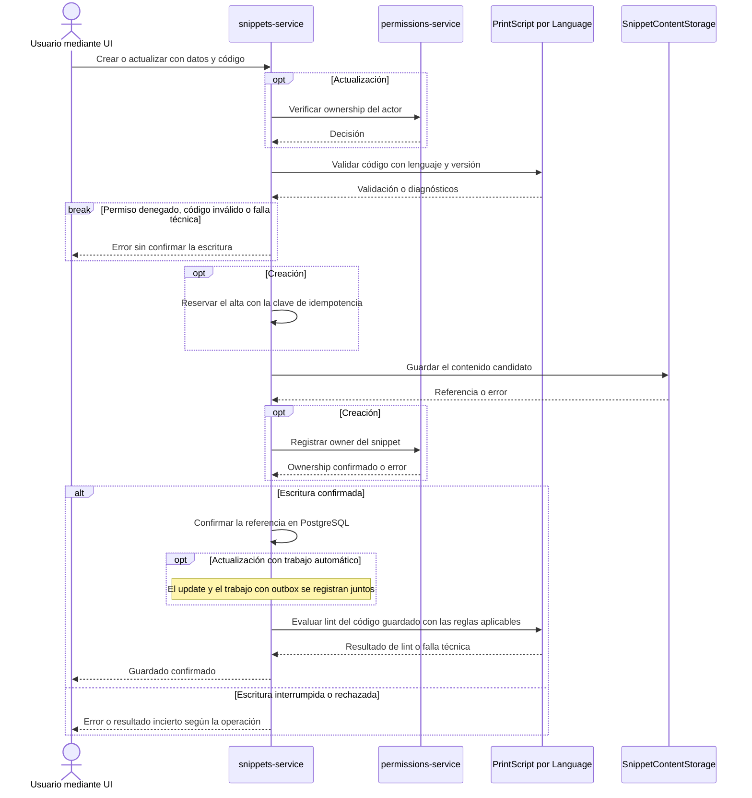

# Creación y actualización de snippets

[Volver al índice](../README.md)

US1–4 permiten guardar código del editor o de un archivo. Ambos usan los
contratos de creación y actualización de Snippets.

Un alta parcial queda fuera de las consultas hasta confirmarse. El mismo
pedido de creación puede retomarse con la misma identidad y clave de
idempotencia. En un update, la confirmación comprueba la revisión que se está
reemplazando. PostgreSQL, Permissions y storage tienen transacciones separadas.
Las infracciones de lint y los [tests automáticos](tests.md) no revierten el
guardado confirmado.
