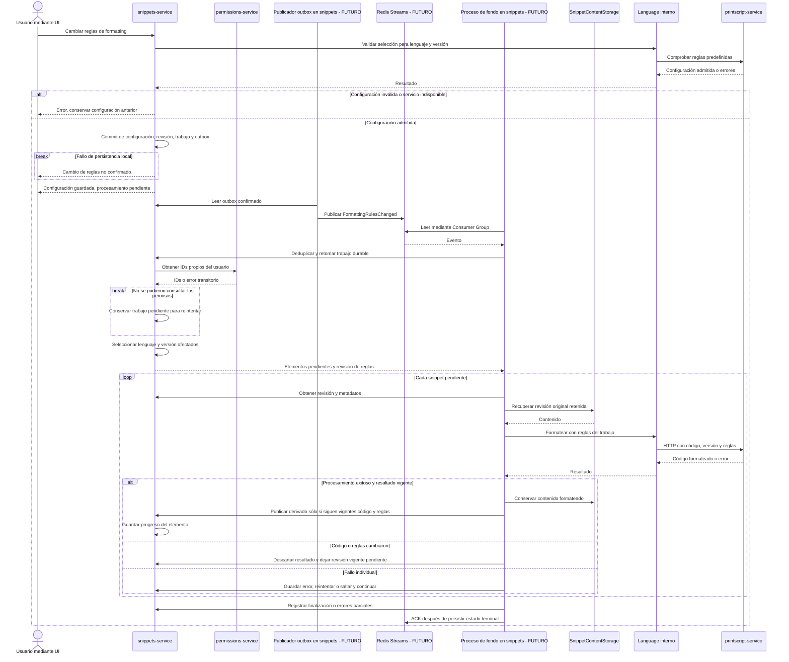

# Formatting y reprocesamiento masivo

[Volver al índice de arquitectura](../README.md)

US11 configura reglas por HTTP síncrono; US12 reprocesa sin hacer esperar al usuario
y con recuperación. US13 conserva original y formateado. La [ADR-001 / SNI-27](../adr-001-async-processing.md)
aprueba `FormattingRulesChanged` + outbox + Redis Streams; el runtime es **futuro**.
Garantías comunes en el [diseño mínimo](../async-processing-design.md).

- **Propuesta:** las reglas pertenecen al owner por lenguaje y versión; afectan sus snippets propios. Reprocesar al habilitar o deshabilitar reglas. Este alcance debe confirmarse con la UI.
- **Diseño:** preservar original y producir un derivado vinculado a código, reglas y procesador. Reutilizar `SnippetContentStorage`; publicación de referencia condicionada a vigencia, sin eliminar blobs ante escritura incierta.
- **Aprobado SNI-27:** trabajo durable en PostgreSQL, outbox transaccional y Consumer Groups en Redis Streams; PrintScript sigue por HTTP. Un fallo de Permissions deja trabajo recuperable sin ACK prematuro; un fallo individual no detiene el lote. El diagrama simplifica la publicación/reentrega: aplicar deduplicación, reservas y recuperación del diseño común.
