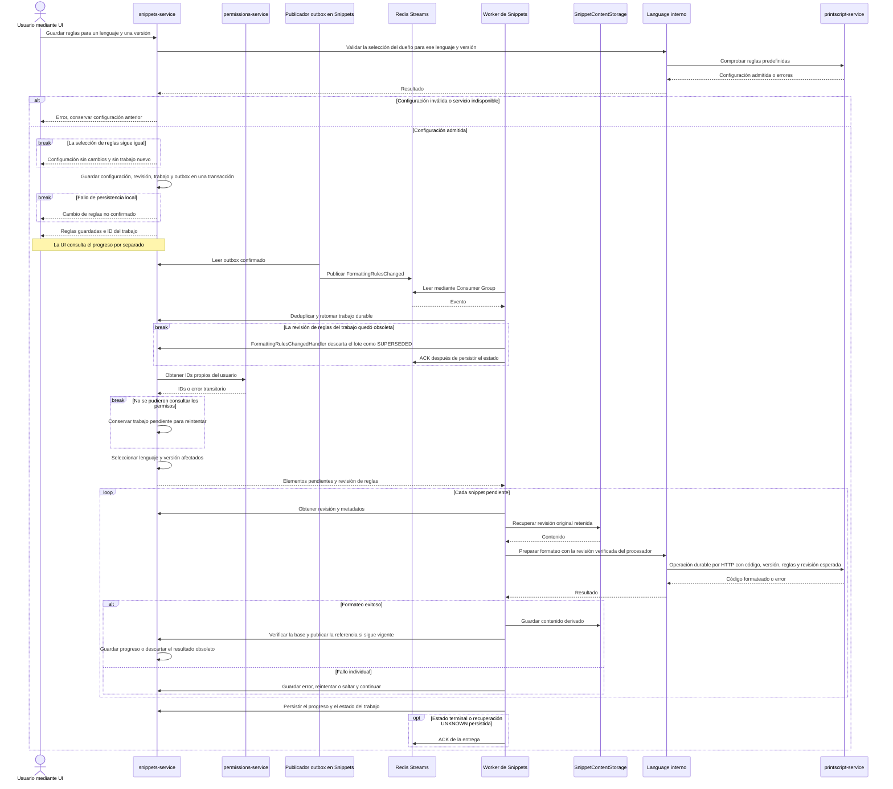

# Formatting y reprocesamiento masivo

[Volver al índice de arquitectura](../README.md)

US11 configura reglas por HTTP síncrono; US12 reprocesa sin hacer esperar al usuario
y con recuperación. US13 conserva el original y permite descargar el formateado.
El procesamiento implementa `FormattingRulesChanged`, outbox y Redis Streams según
la [ADR-001](../adr-001-async-processing.md). Las garantías comunes están en el
[diseño de procesamiento asíncrono](../async-processing-design.md).

- **Alcance.** Las reglas se guardan por dueño, lenguaje y versión. Un cambio efectivo al habilitar o deshabilitar reglas encola el reformateo de los snippets propios de ese alcance. El guardado queda confirmado al terminar la transacción y el progreso del lote se consulta aparte.
- **Vigencia.** `FormattingBasis` vincula el derivado con la referencia al original, el lenguaje, la versión, la revisión de reglas y la revisión del procesador. La operación remota valida la revisión esperada de PrintScript. Al publicar, `JdbcFormattedVariants` comprueba en la transacción la referencia y los metadatos actuales del snippet y la revisión de reglas. Al reutilizar el derivado, la descarga también comprueba la revisión consultada del procesador.
- **Persistencia y recuperación.** PostgreSQL guarda reglas, trabajo y outbox en la misma transacción. Redis Streams entrega el evento mediante un grupo de consumidores y el progreso durable permite retomar el lote. Un fallo transitorio de Permissions deja el trabajo pendiente. Un fallo individual puede registrarse y el lote sigue con los demás snippets. El derivado se guarda por separado en `SnippetContentStorage`, se conserva el original y una escritura incierta conserva los blobs.
