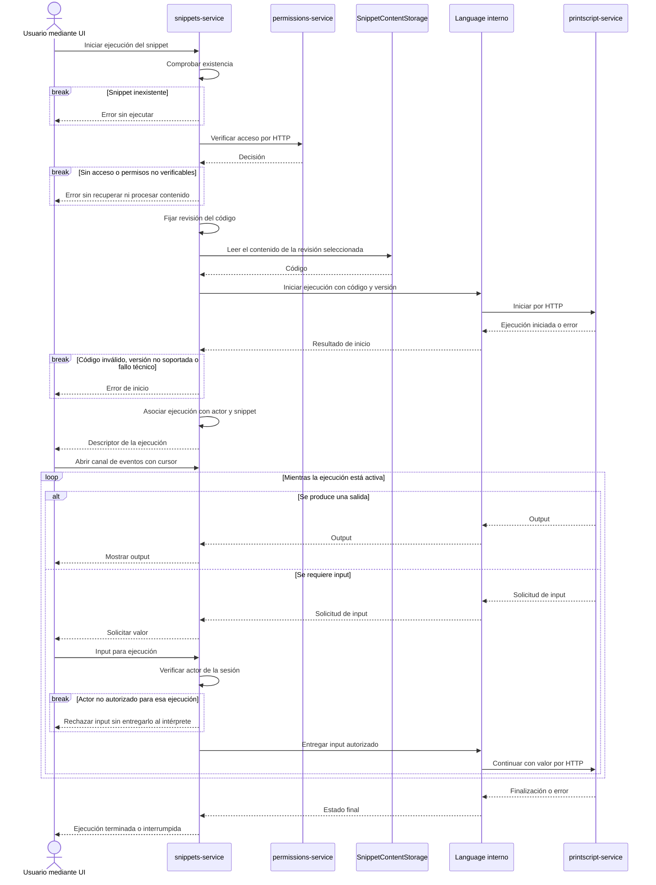

# Ejecución interactiva

El [contrato de ejecución](../execution-contract.md) describe las dos APIs,
los eventos y los límites. La UI recibe NDJSON con `fetch` y usa POST para
inputs y cancelación.

PrintScript conserva el estado transitorio del intérprete. `snippets-service` autoriza el inicio, asocia la ejecución al usuario y transmite outputs y solicitudes de input mediante `Language`, su módulo interno.

Cerrar el stream permite una reconexión acotada por cursor. La cancelación
es una operación separada. La ejecución conserva el snapshot del inicio y
distingue errores del programa, límites y fallas técnicas.

[Volver a la referencia de arquitectura](../README.md)
