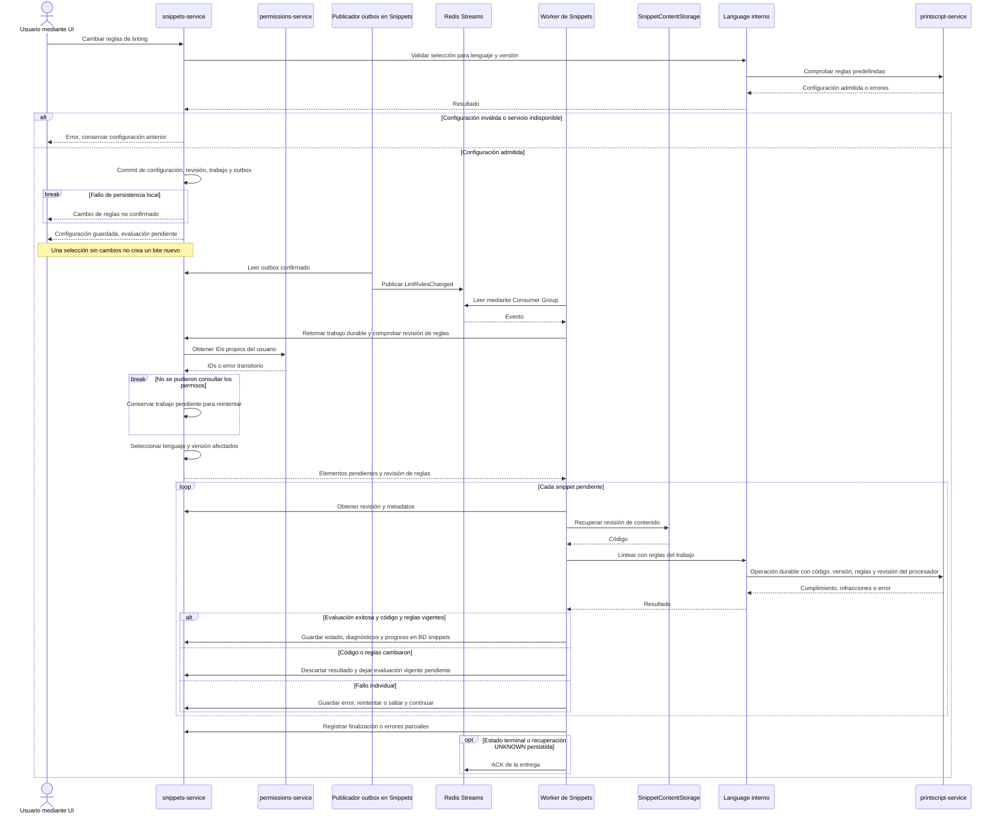

# Linting y reprocesamiento masivo

[Volver al índice de arquitectura](../README.md)

US14 configura reglas por HTTP síncrono; US15 evalúa snippets en segundo plano con
recuperación. Los resultados alimentan listado y detalle. El evento
`LintRulesChanged` usa outbox y Redis Streams según el
[modelo de procesamiento asíncrono](../async-processing-design.md).

- Las reglas se guardan por dueño, lenguaje y versión. Se evalúan los snippets
  propios de ese alcance y sólo se exponen resultados vigentes.
- Una falla técnica se distingue de una infracción. El lint conserva el código
  original. PrintScript conoce el catálogo y Snippets persiste el resultado.
- La evaluación se recupera desde el trabajo durable y verifica vigencia al
  publicar, incluyendo la revisión de código, reglas y procesador.
