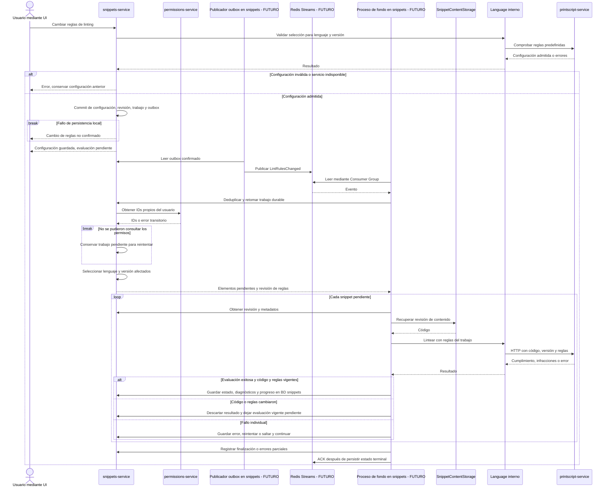

# Linting y reprocesamiento masivo

[Volver al índice de arquitectura](../README.md)

US14 configura reglas por HTTP síncrono; US15 evalúa snippets en segundo plano con
recuperación. Los resultados alimentan listado y detalle. La [ADR-001 / SNI-27](../adr-001-async-processing.md)
aprueba `LintRulesChanged` + outbox + Redis Streams; el runtime es **futuro**.
Garantías comunes en el [diseño mínimo](../async-processing-design.md).

- **Propuesta:** configuración por owner, lenguaje y versión; sólo se procesan sus snippets propios. El catálogo y significado de reglas pertenecen a PrintScript; la selección y los resultados persistidos pertenecen a snippets-service.
- **Requerimiento:** linting informa infracciones. **Propuesta:** distinguir cumple, incumple, pendiente y no evaluado por error. Una caída del procesador no significa incumplimiento; linting no modifica el código ni reemplaza la validación del parser.
- **Aprobado SNI-27:** progreso en PostgreSQL, outbox y Consumer Groups en Redis Streams; workers dentro de Snippets con HTTP por elemento. Caída de Permissions deja trabajo recuperable sin ACK prematuro; resultados superados no se publican como actuales. Se usa la abstracción de storage existente. El diagrama simplifica reentregas: aplicar deduplicación, reservas y recuperación del diseño común.
