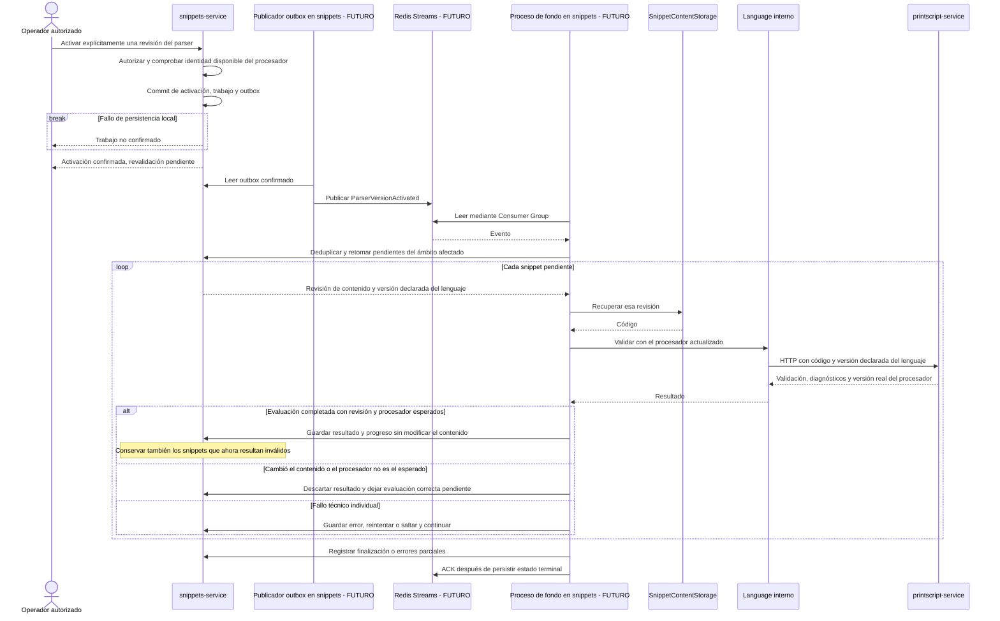

# Revalidación ante una nueva versión del parser

[Volver al índice de arquitectura](../README.md)

La consigna exige revalidar al cambiar el parser. La [ADR-001 / SNI-27](../adr-001-async-processing.md)
aprueba una **activación administrativa explícita**, seguida de outbox y evento
`ParserVersionActivated` por Redis Streams. El deploy por sí solo no dispara trabajo.
Runtime futuro sobre snippets del ámbito afectado, sin cambiar su versión declarada
de lenguaje. Garantías comunes en el [diseño mínimo](../async-processing-design.md).

- **Aprobado SNI-27:** activación de sistema autorizada y auditable, con alcance por lenguaje/versiones afectadas para todos los owners; separada de desplegar imágenes. No usa tokens de usuario ni headers dev en workers. El mecanismo administrativo se concreta en la implementación, sin inventar un usuario global.
- **Propuesta:** distinguir versión del lenguaje, versión del procesador y revisión del contenido. Conservar los snippets que pasan a ser inválidos y sus diagnósticos; no migrar lenguaje, borrar contenido ni reejecutar automáticamente tests o formatting sin otro requerimiento.
- **Aprobado SNI-27:** outbox, Redis Streams y progreso durable en PostgreSQL; continuar ante errores individuales. Language selecciona la integración; PrintScript valida por HTTP y no consume Redis. La identidad verificable del procesador es una capacidad interna pendiente; el diagrama no afirma que esté disponible actualmente. Reutilizar storage y recuperación del diseño común.
