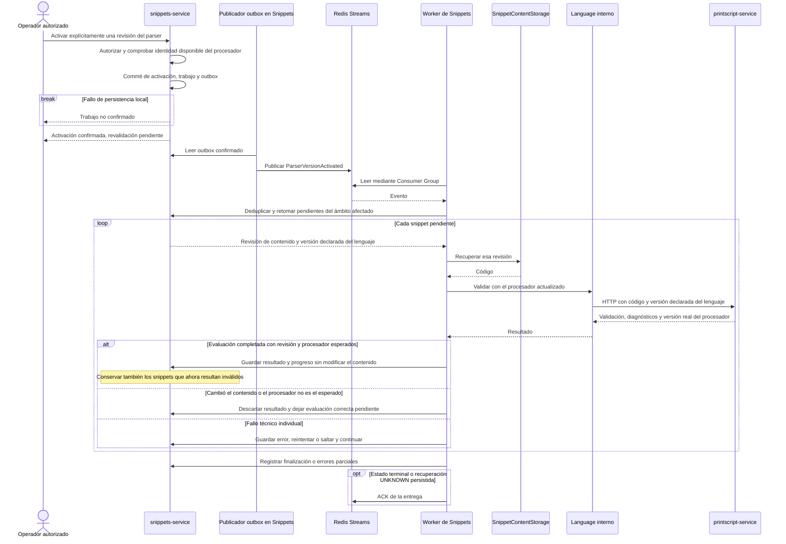

# Revalidación ante una nueva versión del parser

[Volver al índice de arquitectura](../README.md)

Una activación administrativa explícita registra el evento
`ParserVersionActivated`. El worker revalida los snippets del ámbito afectado
y conserva su versión declarada de lenguaje. El despliegue de una imagen por
sí solo no encola trabajo. [Procesamiento asíncrono](../async-processing-design.md).

La activación usa un comando interno auditable, un ámbito por lenguaje y
versiones, y una identidad verificable del parser. La revalidación conserva
el código y guarda diagnósticos aunque el snippet pase a ser inválido.
[Comando y contrato en Snippets](https://github.com/JJT-INGSIS/snippets-service/blob/dev/docs/parser-revalidation.md).
