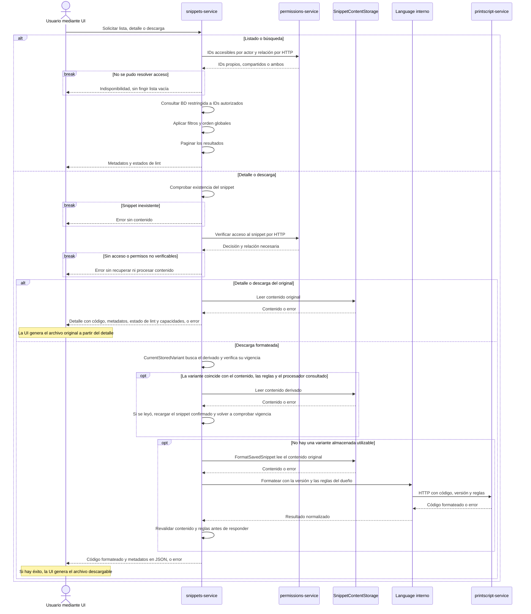

# Búsqueda, visualización y descarga

`permissions-service` determina el universo accesible mediante IDs; `snippets-service` aplica filtros y orden, y entrega contenido y resultados vigentes. La descarga formateada puede requerir procesamiento puntual mediante el módulo interno `Language`.

- US5–6 cubren listado y detalle de snippets propios y compartidos, con filtros, orden y estado de lint. US13 permite descargar el original y el formateado.
- La autorización delimita el listado antes de aplicar filtros, orden y paginación. El listado usa metadatos y estados de lint ya registrados.
- `CurrentStoredVariant` compara la referencia al original, el lenguaje, la versión, la revisión de reglas del dueño y la revisión consultada del procesador. Después de leer el derivado, vuelve a comprobar la base con el snippet y las reglas recargados y la misma revisión del procesador.
- `FormatSavedSnippet` formatea bajo demanda cuando falta un derivado utilizable, sin persistir una variante. Si cambia el contenido o las reglas durante el formateo, vuelve a intentar con la revisión actual o informa que el resultado perdió vigencia. Una falla de formato conserva el original.
- Los fallos de acceso o de lectura del contenido necesario se informan como errores. El estado de lint distingue resultados pendientes, fallas técnicas e infracciones.

- Los contratos implementados de listado y detalle están en [reading.md de Snippets](https://github.com/JJT-INGSIS/snippets-service/blob/dev/docs/reading.md). La consulta de IDs accesibles está en [access.md de Permissions](https://github.com/JJT-INGSIS/permissions-service/blob/dev/docs/access.md).

[Volver a la referencia de arquitectura](../README.md)
