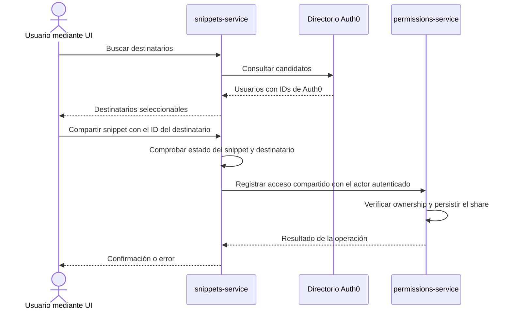

# Sharing y permisos

[Volver al índice](../README.md)

El dueño comparte un snippet confirmado con otro usuario. El directorio de
Auth0 permite buscar destinatarios por medio de Snippets.

El share permite lectura y ejecución autorizada. Edición y sharing quedan a
cargo del dueño. Permissions conserva las relaciones de forma idempotente. El
contenido y los tests siguen asociados al original.
[Contrato de Snippets](https://github.com/JJT-INGSIS/snippets-service/blob/dev/docs/sharing.md) ·
[Contrato de Permissions](https://github.com/JJT-INGSIS/permissions-service/blob/dev/docs/access.md).
