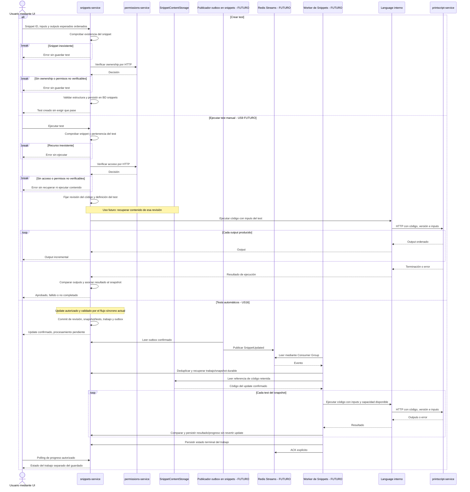

# Tests: creación y ejecución

US8–10 se precisan en el [contrato SNI-45](../execution-contract.md).
Canal aprobado: NDJSON con `fetch`, inputs mediante POST, snapshot y comparación.
US16 permanece fuera de SNI-45 y usa la [ADR-001 / SNI-27](../adr-001-async-processing.md):
`SnippetUpdated`, outbox y Redis Streams después de confirmar una actualización.
Es diseño futuro; no acredita workers ni aceptación funcional integrada.

`snippets-service` conserva las definiciones y compara salidas reales con esperadas. `Language`, módulo interno, delega la ejecución a PrintScript por HTTP; los tests automáticos se ejecutan después de confirmar una actualización.

- **Requerimientos:** crear un test requiere ser owner y admite expectativas que no se cumplan; ejecutar manualmente requiere acceso y entrega output incremental en la futura US9. US16 ejecuta todos los tests tras actualizar, sin revertir el guardado.
- **Contrato US8–10 aprobado por Thiago:** snapshot coherente de código y definición; comparación exacta de secuencias, sin normalización. Una ejecución activa por actor y cuatro globales inicialmente, con un coordinador por servicio y sin cola. Ver detalles y trade-offs en SNI-45; no son capacidades runtime ya verificadas.
- **Errores y persistencia:** diferencia de outputs tras finalización normal es test fallido; falla técnica o inicio incierto es otro resultado. El canal del intérprete conserva retención acotada; no confundirla con auditoría de negocio. SNI-48 tiene historial durable interno aprobado y PR #47 en revisión al consultar Linear el 29/10/2026; verificar integración antes de reutilizarlo.
- **Aprobado SNI-27 / US16 futuro:** cada update confirmado conserva trabajo y snapshot durable de código/tests. Una edición posterior puede borrar el blob activo anterior: retener la referencia necesaria hasta completar el trabajo. Resultados históricos no se presentan como actuales. Reentregar un evento no autoriza repetir un inicio PrintScript incierto. Backpressure, ACK y recuperación están en el [diseño mínimo](../async-processing-design.md).

[Volver a la referencia de arquitectura](../README.md)
