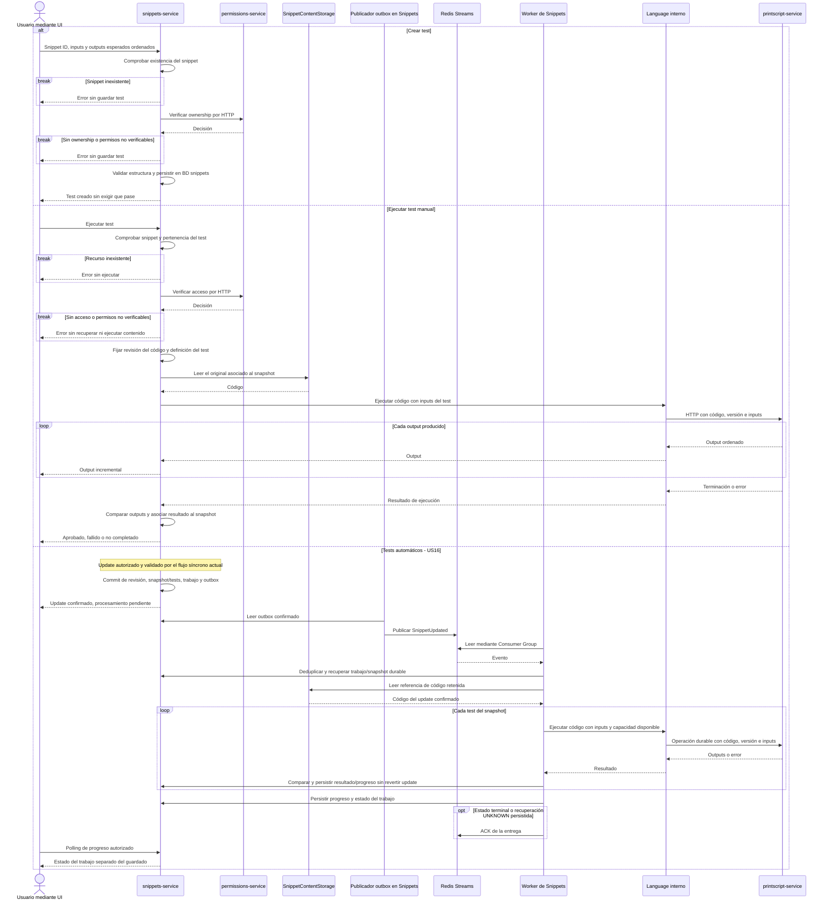

# Tests: creación y ejecución

El [contrato de ejecución](../execution-contract.md) describe el canal NDJSON,
el snapshot y la comparación de resultados. Los tests automáticos usan
`SnippetUpdated`, outbox y Redis Streams al confirmar una actualización
según el [modelo asíncrono](../async-processing-design.md).

`snippets-service` conserva las definiciones y compara salidas reales con esperadas. `Language`, módulo interno, delega la ejecución a PrintScript por HTTP; los tests automáticos se ejecutan después de confirmar una actualización.

El dueño administra los tests. Un usuario con acceso puede ejecutar un test
del snippet. La comparación usa la secuencia exacta de outputs. Una
discrepancia tras terminar normalmente se distingue de una falla técnica.

Los tests automáticos usan el código y las definiciones del snapshot del
update. Una edición posterior invalida su vigencia para el resultado actual.
El guardado del snippet se confirma en una operación separada del resultado
del lote.

[Volver a la referencia de arquitectura](../README.md)
