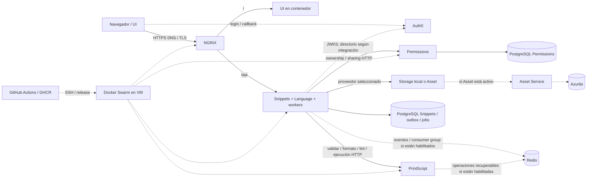

# SNI-79 — Base de observabilidad

Estado: relevamiento inicial documentado. Fuente de requisitos: presentación de observabilidad
de la cátedra, decisiones del equipo y tickets SNI-79–88. El diagrama describe
componentes y conexiones disponibles en el proyecto; su presencia en cada VM se
acredita por separado, no por aparecer en este archivo.

## Arquitectura a relevar

`Language` es parte de Snippets. Redis utiliza una réplica según el diseño
registrado; un stream/handler que existe en código puede estar deshabilitado en
una VM. El servicio de observabilidad será externo y los agentes se preparan en
los tickets posteriores. No se asume disponibilidad ni alta disponibilidad por
dibujar una dependencia.

## Evidencia e inventario por ambiente

| Componente / configuración | DEV | PROD | Fuente / verificación pendiente |
| --- | --- | --- | --- |
| VM, Swarm, NGINX, UI y servicios | Tareas presentes con 1/1 réplicas al consultar | Tareas presentes con 1/1 réplicas al consultar | Consultas SSH de sólo lectura del 09/11/2026 |
| Redis y volumen persistente | Servicio presente con 1/1 réplicas; prueba AOF anterior acreditada el 02/11 | No aparece un servicio Redis en el stack ni como infraestructura en el release consultado | [SNI-56 DEV](../sni-56-dev-verification.md); inventarios remotos |
| Publisher, worker y capacidad | Deshabilitados al cierre de SNI-56; configuración actual por comprobar | Por comprobar | Flags efectivos de Snippets, sin imprimir secretos |
| PrintScript y operaciones Redis | Stack prevé conexión privada; activación actual por comprobar | Por comprobar | `swarm/stack.redis.yaml`, configuración efectiva y versión |
| Storage | `local` en release confirmado | `local` en release confirmado | Consulta de release y servicios del 09/11/2026 |
| Auth0 | Recursos DEV preparados; activación remota por comprobar | Recursos PROD de Auth0 pendientes en SNI-71; estado actual por comprobar | `auth0/development.public.json`, SNI-74 y configuración efectiva |
| New Relic | Cuenta creada; presencia de agentes sin comprobar | Cuenta creada; presencia de agentes sin comprobar | Alta confirmada por el usuario; no se ha inspeccionado el proceso agente en las VMs |

### Consulta de DEV — 09/11/2026

Consulta SSH de sólo lectura con host verificado, después de que el usuario encendió
la VM. `docker service ls` mostró 1/1 para NGINX, UI, Snippets, Permissions,
PrintScript, ambas bases y Redis. No aparecieron Asset ni Azurite en el inventario.
El release confirmado declara `storage_provider=local`, infraestructura `nginx`
y `redis`, y checks previos de convergencia y SQL/HTTP aprobados. Esos checks son
del release y no sustituyen una nueva prueba funcional.

Las etiquetas de las imágenes activas registran las siguientes revisiones:

| Servicio | Revisión de código de la imagen |
| --- | --- |
| Snippets | `5ca5bf833e8f1ccd0f265ec434f6df268ce447f8` |
| Permissions | `500331e2a97bbc61c29ae1a215589a1c57ba052d` |
| PrintScript | `6dff7224e609c94decd9e09eefee231680d397f0` |
| UI | `21d3fea0fc829f54b9569f8fcae578a79075e677` |

La consulta de GitHub del mismo día identificó `dev` en Snippets `ea5e6db`,
Permissions `500331e`, PrintScript `f8d455b` y UI `fea965b`. Por lo tanto las
imágenes de Snippets, PrintScript y UI no corresponden al último commit de su
respectiva rama dev. Los últimos pipelines de esas tres ramas figuran fallidos;
el de Permissions figura exitoso y su revisión coincide con la imagen.
Esto documenta una diferencia de versiones, no una conclusión sobre la salud
funcional ni una autorización para reejecutar despliegues.

La inspección seleccionó sólo flags no sensibles. Los servicios backend declaran
perfil `dev`; la especificación de Snippets no declara `AUTH_MODE`,
`SNIPPETS_OUTBOX_ENABLED`, `SNIPPETS_WORKER_ENABLED` ni `SNIPPETS_CAPACITY_ENABLED`.
En el código de Snippets `5ca5bf8`, el perfil dev usa `AUTH_MODE=dev` por defecto
y outbox/worker/capacidad usan `false` por defecto. La ausencia en la especificación
de servicio no descarta otra fuente de configuración. PrintScript no declara
`PRINTSCRIPT_OPERATIONS_ENABLED` y el registro no contiene sección `auth`.
Confirmar configuración efectiva antes de concluir qué handlers están activos.
Los cambios de código más recientes pueden no estar desplegados: contrastar cada
revisión con su pipeline y release.

### Consulta de PROD — 09/11/2026

Consulta SSH de sólo lectura con host verificado, después de que el usuario encendió
la VM. `docker service ls` mostró 1/1 para NGINX, UI, Snippets, Permissions,
PrintScript y ambas bases. Redis, Asset y Azurite no aparecieron en esa lista. El
release confirmado declara `storage_provider=local`, infraestructura `nginx` y
checks previos de convergencia y SQL/HTTP aprobados. Los checks corresponden al
release registrado y no sustituyen una prueba funcional ejecutada durante esta
consulta.

| Servicio | Revisión de código de la imagen |
| --- | --- |
| Snippets | `3ce8ff09747212bd2564bf7c3158ea3203a86786` |
| Permissions | `6de40e6701a91d38e97a887154d6c2c2afba6757` |
| PrintScript | `5a4222b9892430d3728d1b75cbde8d117b0f8d11` |
| UI | `bca8783dda6954b7e905faccd732e2e4e3eee3fd` |

Los servicios backend declaran perfil `prod`. Los flags de Auth0, outbox,
worker, capacidad y operaciones de PrintScript consultados no están declarados
en los entornos de servicio y no hay sección `auth` en el release. Su ausencia
no prueba todos los defaults efectivos de las imágenes. Confirmar modo de
identidad y capacidades en el código de esas revisiones antes de afirmarlos.

Los manifiestos versionados de bootstrap no sustituyen el release confirmado en
la VM. Anotar fecha, fuente y alcance de cualquier verificación nueva. Un servicio
en estado `Running` no acredita que responda una operación de negocio.

## Matriz de fallos y cobertura propuesta

Las señales y umbrales son propuestas de trabajo, no alertas ya instaladas.
Los responsables de implementación remiten a tickets; responde quien esté disponible,
sin guardias ni rotación on-call.
Los ensayos y la evidencia de la defensa se detallan en la preparación de
[SNI-87](../observability/sni-87-failure-acceptance.md).

| Origen → destino / componente | Falla e impacto | Señal / aviso propuesto | Ticket | Prueba y recuperación |
| --- | --- | --- | --- | --- |
| Cliente → DNS / TLS / NGINX | DNS, certificado o ingreso inaccesible; usuario no entra | Synthetic externo y aviso de vencimiento de TLS | SNI-84 | Fallo controlado en DEV; restaurar ingreso y comprobar recuperación |
| NGINX → UI | Upstream no responde; página inaccesible | Check de contenido, disponibilidad de tarea y errores upstream | SNI-80/84 | Interrumpir UI en DEV y restaurar |
| NGINX → Snippets | API inaccesible o lenta | Check `/api/languages`, errores/latencia upstream | SNI-80/84 | Interrumpir ruta/API y restaurar |
| UI → Auth0 / callback | No se puede iniciar sesión | Recorrido de prueba y errores de redirección | SNI-85, SNI-73/74 | Fallo simulado con fixture aislado; recuperar login |
| Snippets → JWKS / directorio | Falla técnica de claves o directorio; autorización/sharing afectado | Errores y latencia de proveedor, separados de 401/403 esperados | SNI-81/85, SNI-74 | Simular timeout controlado y recuperación |
| Snippets → PrintScript | Timeout, error técnico o stream interrumpido; validación/ejecución no termina | Spans, errores técnicos, latencia y estado del proveedor | SNI-81/86 | Interrumpir PrintScript durante alta; restaurar y repetir |
| Snippets → Permissions | Timeout o error; ownership/sharing no se confirma | Spans y errores técnicos separados de denegaciones válidas | SNI-81/86 | Interrumpir Permissions con fixture; restaurar |
| Snippets → PostgreSQL Snippets | Error, bloqueo o saturación; operación/trabajo no persiste | Disponibilidad, conexiones, bloqueo, latencia y disco | SNI-82/86 | Falla aislada y recuperación, conservando datos |
| Permissions → PostgreSQL Permissions | Error o bloqueo; permisos no disponibles | Señales de la segunda BD, etiquetadas por servicio | SNI-82/86 | Falla aislada y recuperación |
| Snippets → storage local | Lectura/escritura o disco falla; contenido inaccesible | Probe con fixture, errores y disco | SNI-82/86 | Fixture aislado y restauración |
| Snippets → Asset → Azurite | Si está activo: fallo HTTP o blob; contenido inaccesible | Señales por tramo y prueba de lectura/escritura | SNI-82/86 | Ensayar sólo el proveedor activo y restaurar |
| PostgreSQL → outbox → Redis | Publicador o Redis falla; evento no se publica | Conteo y edad de outbox sin publicar, errores de publicación | SNI-83/86 | Simular fallo de publicación; comprobar recuperación |
| Redis → consumidor → job | Consumidor detenido; trabajo no progresa | Lag, PEL y edad de job elegible sin avance | SNI-83/86 | Pausar consumidor con publicador y Redis sanos; recuperar |
| Worker → PrintScript / capacidad | Operación falla o queda incierta; capacidad retenida | Reintentos sostenidos, UNKNOWN, reservas y progreso | SNI-83/86 | Simular resultado incierto y verificar recuperación segura |
| VM → Swarm / contenedores | VM, tarea o proceso cae; múltiples flujos afectados | Heartbeat, tareas esperadas/disponibles, reinicios, OOM | SNI-80/84/86 | Ensayo autorizado en DEV y check externo |
| GitHub → GHCR → SSH → Swarm | CI/CD falla o queda versión anterior | Resultado por etapa y release/digest efectivo | SNI-80/86 | Contrastar workflow y release confirmado |
| Agente → New Relic → teléfono | Sin telemetría o aviso; incidente sin detectar | Pérdida de señal y prueba real de destino | SNI-80/84 | Interrumpir señal controlada, verificar aviso y restauración |
| Usuario → listado / contenido | HTTP 200 con datos equivocados; snippet esperado no aparece | Synthetic con identidad y fixture conocidos | SNI-85/86 | Omitir fixture de forma controlada sin borrar datos reales |

## Convención inicial propuesta

Usar `environment=dev|prod`, `service` con nombre estable y `version` del
despliegue. Incorporar `trace.id`/`span.id` y `X-Request-ID` en logs/trazas cuando
aplique; `correlationId`, `eventId` y `jobId` en trabajo asíncrono. Mantener IDs
únicos fuera de las dimensiones de métricas. Ajustar los nombres a los campos
efectivamente soportados por la cuenta/agentes durante el piloto.

Excluir bearer, contraseñas, secretos, contenido de snippets e inputs de ejecución.
La licencia de ingesta y la credencial administrativa para IaC son distintas y se
gestionan por un mecanismo de secretos, sin añadir valores al repo ni al chat.
Definir retención y rotación local sin generar doble envío de la misma fuente.

### Valores concretos para el piloto

Propuesta para SNI-80–86, pendiente de revisión durante su implementación. Usar
las mismas claves en ambos ambientes. Para APM, los nombres recomendados son
`snippet-searcher-dev-snippets`, `snippet-searcher-dev-permissions` y
`snippet-searcher-dev-printscript`, cambiando `dev` por `prod` según corresponda.
Para los hosts usar `vm-snippet-dev` y `vm-snippet-prod` si coincide con el nombre
efectivo. Entidades adicionales: `nginx`, `ui`, `snippets-db`, `permissions-db`,
`redis` y los componentes del proveedor de storage si están activos. El nombre
visible de la entidad no sustituye las etiquetas `environment`, `service` y
`version`; verificar los nombres de atributo que acepten cada agente y producto.

Enviar inicialmente errores y eventos de negocio útiles, trazas muestreadas y
métricas de disponibilidad, latencia, tráfico y saturación. En logs de listado
se puede incluir el conteo; un conteo cero por sí solo no abre una alerta. No
indexar IDs de usuarios, snippets, eventos o trabajos como dimensiones de métricas.
Anotar versión de agentes, tasa de ingesta, CPU, RAM y disco antes y después del
piloto. No activar dos mecanismos de envío para el mismo log.

## Responsables y criterios iniciales de incidentes

Los responsables técnicos son Juanchi para APM, trazas, logs y jobs asíncronos;
Thiago para infraestructura, PostgreSQL, Redis, storage y ensayos de fallos; y
Juanfran para Synthetics, dashboards, SLI/SLO, alertas y notificaciones. No son
guardias: las alertas son compartidas y responde quien esté disponible. Cada regla
se prueba en DEV antes de fijar un umbral definitivo.

| Severidad | Ejemplo | Destino previsto |
| --- | --- | --- |
| Crítica | API caída, synthetic funcional fallando o procesamiento esencial detenido de forma sostenida | Correo a los tres y llamada si la integración gratuita está validada y autorizada |
| Warning | Outbox acumulado, jobs retrasados, latencia o saturación sostenidas | Correo a los tres, sin llamada |
| Informativa | Deploys y eventos operativos normales | Registro o dashboard |

El destino grupal propuesto es un único destino de correo con las tres direcciones;
debe configurarse y verificarse en SNI-84/86. No llamar por errores HTTP esperados,
fallos aislados ni apagados intencionales de DEV. Silenciar DEV durante esos apagados;
las llamadas de prueba se habilitan explícitamente, y las de PROD sólo después de
validación y autorización. Para cada alerta documentar condición, severidad, ambiente,
responsable técnico, destino, dashboard, primer diagnóstico y condición de resolución.

| Incidente agrupado | Condición propuesta para empezar | Responsable técnico propuesto | Primera acción |
| --- | --- | --- | --- |
| Ingreso público / DNS / TLS / proxy / UI | Synthetic externo falla de forma consecutiva o el certificado se aproxima a su vencimiento | Juan Francisco (SNI-84/85); Juanchi para ingreso (SNI-80) | Comparar check público, `/healthz` del proxy, UI y logs de upstream |
| API Snippets | Check público de API falla consecutivamente o errores técnicos/latencia se mantienen sobre umbral con tráfico suficiente | Juan Francisco (SNI-84/86); Juanchi (SNI-81) | Abrir estado de tareas, errores, una traza y llamadas a dependencias |
| Resultado funcional incorrecto | Check del usuario y snippet conocidos no encuentra el fixture o no lee el contenido esperado | Juan Francisco (SNI-85) | Revisar identidad de prueba, respuesta de listado y cadena Permissions/storage |
| Dependencia Auth0 / JWKS / directorio | Fallos técnicos o timeout sostenidos en login o consulta de claves/directorio | Juan Francisco (SNI-85/86); coordinar SNI-74 con Thiago | Revisar errors de proveedor y último cambio, distinguiendo errores de usuario |
| PrintScript / Permissions | Timeouts o fallas técnicas sostenidas de la dependencia | Juanchi (SNI-81); Juan Francisco (SNI-86) | Verificar tarea, conexión y tramo afectado en traza |
| PostgreSQL / Redis / storage | Probe falla consecutivamente, disco/memoria bajo presión o errores de persistencia | Thiago (SNI-82); Juan Francisco (SNI-86) | Identificar instancia y señal; consultar runbook antes de restaurar |
| Outbox / consumidor / job | Evento elegible sin publicar o job elegible sin avance durante ventana acordada; UNKNOWN sostenido o capacidad retenida | Juanchi (SNI-83); Juan Francisco (SNI-86) | Contrastar outbox, lag/PEL, estado durable y reserva; no reiniciar ejecución incierta a ciegas |
| VM / agente / despliegue | Pérdida sostenida de señal o tarea ausente; CI/CD falla o versión esperada no converge | Juanchi (SNI-80); Juan Francisco (SNI-84/86) | Comparar synthetic externo, señal del host, tareas y resultado del último deploy |

Punto de partida para disponibilidad: dos checks consecutivos fallidos. Para
heartbeats, considerar pérdida de señal después de 3–5 minutos. Son parámetros
de ensayo, no SLO comprometidos ni tiempos garantizados; verificarlos con la
frecuencia real, tráfico, inicio del servicio y horarios antes de habilitar avisos.
Agrupar síntomas de una caída y registrar recuperación. Definir un procedimiento
de mantenimiento antes de apagar DEV; no se ha creado ningún silenciamiento.

## Cuenta, presupuesto y decisiones abiertas

| Tema | Estado y siguiente paso |
| --- | --- |
| Organización/cuenta New Relic | Cuenta `8718557`, creada por el usuario el 09/11/2026. La pantalla del plan muestra 100 GB de ingesta y un usuario Full Platform incluidos en el tramo gratuito; revisar uso y condiciones vigentes en la cuenta |
| Región y accesos | El usuario seleccionó United States y figura como Full Platform. Confirmó que agregó a Juanchi y Thiago como Basic; verificar aceptación, grupo User y permisos efectivos al empezar sus tickets. Basic tiene limitaciones en vistas APM/infra |
| Claves y aprovisionamiento | Cuenta creada; definir entrega segura y separar clave de ingesta de permisos de administración. Aún no se han creado ni distribuido credenciales en SNI-79 |
| Ingesta, retención y logs | Pantalla del plan muestra 0/100 GB ingeridos al consultar; referencia inicial revisable de 10 GB/mes. Medir piloto y verificar retención y facturación efectiva |
| Synthetics | Revisar checks incluidos y costo antes de fijar frecuencia y ubicaciones |
| Teléfono | Se busca una llamada real automática durante la defensa. Primera opción: Twilio Free Trial, condicionado a verificar gratuidad, disponibilidad para el celular argentino y una integración segura con deduplicación. Alternativa: push y correo si no resulta viable gratis; no se realizaron llamadas |
| Defensa | Ensayos controlados en DEV de indisponibilidad, resultado funcional incorrecto, worker detenido y, si es viable y se autoriza, llamada. Definir tiempo máximo de detección y teléfono designado |
| DEV apagado | Definir ventana y procedimiento de silenciamiento para apagados esperados |
| SLO | Acordar ventana y objetivos cuando haya mediciones; no asumir que ejemplos de clase son compromisos |

### Dimensionamiento preliminar sujeto a la cuenta

La documentación pública consultada el 09/11 describe en Free hasta 100 GB/mes
de ingesta, un usuario Full Platform y usuarios Basic gratuitos; las vistas y
permisos dependen del tipo. Los checks sintéticos incluidos se publican por edición
y tipo de monitor; la tabla consultada indica 500/mes en Free y excluye los monitores
simple ping de esa tabla. Verificar región, edición, políticas de facturación y
condiciones reales de la cuenta antes de adoptar estos valores.

Como cálculo de planificación, un check funcional cada seis horas desde una
ubicación ejecutaría aproximadamente 120 checks en 30 días; cada hora serían 720.
Un intervalo de seis horas puede tardar hasta seis horas en detectar una falla,
por lo que **no cumple por sí solo una defensa que requiera aviso rápido**. Para
esa prueba habrá que acordar frecuencia temporal, presupuesto y umbral, y usar
además un check de disponibilidad adecuado. No se ha configurado ningún monitor
ni se ha aprobado una frecuencia definitiva.

Para iniciar el piloto se adopta como referencia interna revisable **10 GB/mes**
de ingesta total, con avisos de consumo al acercarse a 5 GB y 8 GB. Estas cifras
son un presupuesto operativo propuesto y no un límite automático ni garantía de
ausencia de cargos. Confirmar en el plan qué mecanismos de alertas o límites están
disponibles antes de configurarlos; revisar uso por fuente tras el piloto y antes
de habilitar PROD. Conservar la retención que tenga la cuenta hasta verificar
periodos y opciones de edición por tipo de dato; no suponer que se puede modificar
en la edición gratuita. Evitar ingestión de contenido y logs duplicados.

Para el check funcional se propone comenzar con un único monitor por ambiente,
una ubicación y cada seis horas (aproximadamente 120 checks/mes por ambiente).
Ambos ambientes sumarían unos 240 checks en 30 días. Acordar una cadencia temporal
más rápida y reservar checks para ensayos durante la defensa; el synthetic de
disponibilidad de SNI-84 se dimensiona por separado según su tipo y costo real.
Comprobar recuperación y devolver la cadencia después del ensayo. Todas estas
frecuencias siguen siendo propuestas; no se han activado ni aprobado cobros.

Fuentes: [registro y edición Free](https://docs.newrelic.com/docs/accounts/accounts-billing/account-setup/create-your-new-relic-account/),
[tipos de usuario](https://docs.newrelic.com/docs/accounts/accounts-billing/new-relic-one-user-management/user-type/),
[límites de Synthetics](https://docs.newrelic.com/docs/synthetics/synthetic-monitoring/getting-started/monitor-limits/)
[retención](https://docs.newrelic.com/docs/data-apis/manage-data/manage-data-retention/)
y [claves](https://docs.newrelic.com/docs/apis/intro-apis/new-relic-api-keys/).

Coordinar las respuestas con el usuario/equipo. Una duda abierta no impide iniciar
instrumentación local, diagramas o un piloto con valores revisables.

### Evaluación inicial de llamadas para la defensa

Twilio documenta una prueba de 30 días, sin tarjeta, con 75 minutos de voz;
Argentina figura entre los países admitidos. El destinatario debe estar verificado
y pertenecer al país de registro. La cuenta utiliza un número de origen de prueba.
Estas condiciones y la entrega al celular elegido se verificarán en la cuenta antes
de efectuar llamadas, exclusivamente con autorización del usuario.

PagerDuty documenta integración nativa con New Relic y 100 notificaciones SMS o
telefónicas mensuales en Free, pero su tabla no incluye Argentina para llamadas en
cuentas trial y no confirma de forma inequívoca el caso de una cuenta Free nueva.
Por ello se prioriza evaluar Twilio sin asumir que la llamada ya está garantizada.

La propuesta para SNI-84 es un workflow de New Relic con webhook autenticado y una
función mínima hacia Twilio Voice, sin nuevo microservicio de negocio. Debe aceptar
sólo alertas críticas autorizadas y el destinatario configurado, mantener secretos
fuera del repositorio, aplicar deduplicación durable y límite de frecuencia, y poder
desactivarse. Confirmar que la función y el almacenamiento necesario estén disponibles
sin costo en la cuenta antes de adoptarlos; si no, usar correo y push. No comprar,
activar servicios pagos ni llamar sin autorización. Fuentes: [Twilio Trial](https://www.twilio.com/docs/usage/trials),
[Twilio Voice](https://www.twilio.com/docs/usage/trials/try-out-voice),
[precios de PagerDuty](https://www.pagerduty.com/pricing/) y
[países admitidos por PagerDuty](https://docs.pagerduty.com/incident-management/notifications/supported-countries).
