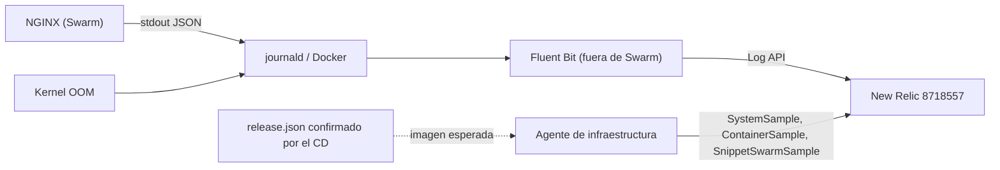

# SNI-80 — Instrumentar la VM de DEV, Swarm y el ingreso NGINX

Revisión de fuentes: 16/11/2026, infra dev `7dc6ca4`.
Estado: **en desarrollo. Diseño aprobado; nada aplicado todavía en la VM.**

Completa lo que el runtime de SNI-82 dejó pendiente
([runbook](../../observability/runtime/README.md)): logs del ingreso y del host,
fallas de tareas y OOM, versión esperada contra la que corre, pérdida de señal y
medición de costo. Sigue la [base común de SNI-79](../architecture/observability-baseline.md):
en la matriz de fallas, ingreso, VM, agente y despliegue son de Juanchi.

## Punto de partida

| Pieza | Estado al empezar | Fuente |
| --- | --- | --- |
| Agente de infraestructura | Contenedor oficial fuera de Swarm; métricas de host y contenedores; ingesta verificada en DEV el 16/11 | `observability/runtime/agent.compose.yaml`, PR #51 |
| Muestra de Swarm | `SnippetSwarmSample`: servicio, imagen, réplicas corriendo y deseadas | `observability/runtime/swarm.sh` |
| Logs | El contenedor del agente no trae forwarder: no llega ningún log | Runbook de SNI-82 |
| NGINX | Log `ingress` en texto `clave=valor` a stdout, con `$request_id`; `X-Request-ID` solo hacia el upstream | `nginx/nginx.conf`, `nginx/templates/routes.conf.template` |
| Release esperado | `swarm/dev-release.json` con imagen y digest por servicio | CD de SNI-43 |
| Licencia | Solo en `/etc/snippet-observability/dev/agent.json`, root 0600 | `scripts/start_observability_dev.py` |

## Señales nuevas

| Señal | Origen | Destino en New Relic | Para qué |
| --- | --- | --- | --- |
| Pedido de ingreso | Log JSON de NGINX | `Log` con `logtype=nginx-ingress` | Errores y latencia por ruta y upstream; correlación por `request_id` |
| OOM del kernel | journald, transporte `kernel` | `Log` con `logtype=host-kernel` | Distinguir un OOM de otra caída |
| Eventos de Docker | journald, unidad `docker.service` | `Log` con `logtype=host-docker` | Reinicios y errores del motor |
| Tareas fallidas | `swarm_sample.py` | `SnippetSwarmSample` (campos nuevos) | Último error, código de salida, 137 = OOM |
| Versión esperada | `swarm_sample.py` + release confirmado | `SnippetSwarmSample` (campos nuevos) | Detectar un deploy que no convergió |
| Pérdida de señal | Ausencia de `SystemSample` / `SnippetSwarmSample` / `Log` | Consultas NRQL | Base de las alertas de SNI-86 |

### Log de ingreso

Una línea JSON por pedido:

| Campo | Contenido |
| --- | --- |
| `request_id` | Generado por NGINX; también vuelve al cliente en `X-Request-ID` |
| `time` | ISO 8601 |
| `method`, `path` | Método y URI **sin query string** |
| `route` | `api`, `executions` o `ui` |
| `status` | Estado devuelto al cliente |
| `upstream`, `upstream_status` | Dirección y estado del upstream (varios si hubo reintento) |
| `request_time`, `upstream_connect_time`, `upstream_response_time` | Segundos |
| `bytes_sent` | Tamaño de la respuesta |

No se registran IP del cliente, `Authorization`, cookies, query string, `Referer`
ni `User-Agent`. Un `X-Request-ID` que mande el cliente se ignora: el identificador
siempre lo genera NGINX.

## Diseño

Fluent Bit corre como contenedor aparte, fuera de Swarm, igual que el agente: si el
stack cae, el forwarder sigue informando. Usa la imagen oficial de Fluent Bit
(`fluent/fluent-bit:5.1.5`, fijada por digest), que ya trae la salida `nrlogs` de New
Relic y la lectura de journald; la imagen de New Relic solo agrega ese mismo plugin.
NGINX pasa a escribir en journald (driver `journald`, tag `snippet-ingress`), así
Fluent Bit lee una sola fuente y no necesita el socket de Docker.

No hay clave nueva. Al arrancar, un script como root lee la licencia de `agent.json`
y genera `/etc/snippet-observability/dev/logs-license.conf` (root, 0600, sin pisar
uno existente), que Fluent Bit monta en solo lectura. La licencia no queda en la
imagen, en el Compose, en variables de entorno ni en el repo.

La muestra de Swarm pasa de `swarm.sh` a `swarm_sample.py` (el agente ya trae
Python), que reutiliza `expected_images` del CD para comparar contra el release
confirmado en `~azureuser/.local/state/snippet-searcher/dev/release.json`.

## Decisiones

Aprobadas por Juan el 16/11/2026 («dale, aprobadas las 9»).

| # | Decisión | Alternativa descartada | Costo aceptado |
| --- | --- | --- | --- |
| O1 | Fluent Bit oficial con su salida `nrlogs`, contenedor fuera de Swarm, reutilizando la licencia de la VM | Cambiar el agente a la instalación nativa con forwarder incluido; imagen de New Relic con el mismo plugin | Un contenedor más y un archivo derivado de la licencia |
| O2 | Solo líneas de acceso de NGINX y, de journald, OOM del kernel y eventos de Docker | Todos los logs de contenedores | Los logs de las aplicaciones quedan para SNI-81 |
| O3 | Log JSON de NGINX con ruta, upstream y tiempos, sin query, IP ni credenciales; `X-Request-ID` generado y devuelto al cliente | Mantener el formato `clave=valor` y parsearlo | Cambia el formato que otros scripts podrían leer |
| O4 | `SnippetSwarmSample` suma tareas fallidas recientes, último error y código de salida; OOM del kernel por log | Un colector nuevo para tareas | Una llamada más a la API de Docker por intervalo |
| O5 | Imagen esperada desde el release confirmado contra la que corre; diagnóstico de etapa del CD documentado | Marcadores de deploy de New Relic | Los marcadores quedan como propuesta aparte |
| O6 | Consultas NRQL de pérdida de señal, sin crear alertas | Crear las alertas acá | Las alertas son de SNI-86 |
| O7 | Medición antes/después de ingesta, CPU y RAM contra el presupuesto de 10 GB/mes | Estimar sin medir | Una ventana de medición en DEV |
| O8 | PROD parametrizado, sin aplicar | Activar PROD con un flag | PROD necesita su propio inventario (SNI-88) |
| O9 | Operaciones en Azure y en la VM solo por Juan o con aprobación paso a paso | Automatizarlas desde el repo | Pasos manuales en el runbook |

## Fronteras

- SNI-79: cuenta, nombres de entidades y presupuesto.
- SNI-81: APM, trazas y logs de las aplicaciones. Este ticket deja el `request_id`
  del ingreso listo para correlacionar.
- SNI-82: el agente y el colector ya instalados; no se cambia su configuración salvo
  `swarm.sh`, que se reemplaza por `swarm_sample.py`.
- SNI-86: dashboards, SLO y alertas sobre estas señales.
- SNI-87: ensayo de fallas.

## Privacidad y presupuesto

- Ningún log lleva IP, tokens, cookies, query string ni cuerpos.
- Los logs de journald se filtran en origen: solo OOM del kernel y la unidad de Docker.
- Límites de memoria y CPU para Fluent Bit, y buffer en disco acotado.
- Referencia de SNI-79: 10 GB/mes, con avisos a 5 y 8 GB. La medición de O7 se anota
  en este documento.

## Forwarder de logs

| Pieza | Valor |
| --- | --- |
| Imagen | `fluent/fluent-bit:5.1.5@sha256:2740f387…e7b4` (multi-arquitectura) |
| Contenedor | `snippet-observability-dev-logs`, fuera de Swarm, `restart: unless-stopped` |
| Privilegios | Raíz de solo lectura, sin capacidades, `no-new-privileges`, sin socket de Docker |
| Montajes | `/var/log/journal` y `/etc/machine-id` en solo lectura; config, parser e include de licencia en solo lectura; volumen propio para cursores y buffer |
| Límites | 128 MiB, 0,25 CPU; 8 MiB en memoria por entrada de NGINX, 2 MiB por entrada de host; buffer en disco de hasta 256 MiB |
| Lectura | Desde el final del journal (`Read_From_Tail`): no reenvía historia vieja al arrancar |
| Envío | `nrlogs` a `log-api.newrelic.com` (cuenta US), gzip, hasta 5 reintentos |
| Archivos | [fluent-bit.conf](../../observability/logs/fluent-bit.conf), [parsers-ingress.conf](../../observability/logs/parsers-ingress.conf), [forwarder.compose.yaml](../../observability/logs/forwarder.compose.yaml) |

[start_log_forwarder_dev.py](../../scripts/start_log_forwarder_dev.py), con `sudo`:

| Acción | Qué hace |
| --- | --- |
| `start` | Exige `agent.json` (no crea una licencia), copia los archivos a `/opt/snippet-observability/dev/logs-v1` (si ya existen, tienen que ser idénticos), genera el include de licencia 0600 sin pisar uno existente, levanta el contenedor y comprueba que corre |
| `remove` | `docker compose down` sin `-v` y borra solo el include de licencia; conserva el volumen de estado y los archivos instalados |

`--environment prod` existe pero no se aplica en este ticket: falla mientras no haya
un `agent.json` de PROD (SNI-88).

## Muestra de Swarm

[swarm_sample.py](../../observability/runtime/swarm_sample.py) corre dentro del agente cada
60 segundos y emite una fila por servicio del stack `snippet-searcher-dev`:

| Campo | Contenido |
| --- | --- |
| `service`, `image` | Nombre corto e imagen de la especificación vigente |
| `expectedImage`, `imageState` | Imagen del release confirmado; `match`, `mismatch` o `unknown` (sin release o servicio fuera de él, como `certbot`) |
| `running`, `desired` | Tareas corriendo y réplicas deseadas |
| `failedTasks` | Tareas `failed` o `rejected` en los últimos 10 minutos |
| `lastError`, `lastExitCode` | De la falla más reciente; el error se recorta a 200 caracteres |
| `oomKilled` | 1 si alguna de esas fallas salió con 137 |

La comparación usa el digest cuando las dos referencias lo tienen. Un nombre de servicio
o imagen con caracteres inesperados hace fallar la muestra entera: no se emiten datos a
medias. No lee environment, secretos ni la especificación completa.

En una VM nueva, `prepare_observability_dev.py` ya instala el script. En la VM de DEV
actual, que tiene `runtime-v1`, se aplica con
[upgrade_observability_runtime_dev.py](../../scripts/upgrade_observability_runtime_dev.py):

| Acción | Qué hace |
| --- | --- |
| `upgrade` | Copia `runtime-v1` a `runtime-v2` sin tocar el original, agrega `swarm_sample.py` y `stack_release.py`, vuelve a generar `integrations.json` con versión `sni80-runtime-v2` y recrea el agente con el mismo proyecto Compose, licencia y volumen de estado |
| `revert` | Recrea el agente con `runtime-v1`; `runtime-v2` queda para inspección |

## Consultas de pérdida de señal y diagnóstico

Son consultas, no alertas: las alertas son de SNI-86. La ventana sigue a SNI-79
(3–5 minutos, con muestras cada 60 segundos). Antes de fijarlas, comprobar los nombres
de atributo con `keyset()` (paso 8): las etiquetas de las integraciones pueden llegar
como `label.environment` en vez de `environment`.

| Para qué | NRQL |
| --- | --- |
| Host sin señal | `SELECT count(*) FROM SystemSample WHERE environment = 'dev' SINCE 5 minutes ago` → 0 |
| Muestra de Swarm sin señal | `SELECT count(*) FROM SnippetSwarmSample WHERE environment = 'dev' SINCE 5 minutes ago` → 0 |
| Forwarder sin señal | `SELECT count(*) FROM Log WHERE logtype = 'nginx-ingress' AND environment = 'dev' SINCE 5 minutes ago` → 0 con el synthetic de SNI-84 activo |
| Servicio sin réplicas | `SELECT latest(running), latest(desired) FROM SnippetSwarmSample WHERE environment = 'dev' FACET service SINCE 5 minutes ago` |
| Versión que no convergió | `SELECT latest(imageState), latest(image), latest(expectedImage) FROM SnippetSwarmSample WHERE environment = 'dev' FACET service SINCE 10 minutes ago` |
| Reinicios y OOM | `SELECT max(failedTasks), max(oomKilled), latest(lastError) FROM SnippetSwarmSample WHERE environment = 'dev' FACET service SINCE 30 minutes ago` |
| OOM del kernel | `SELECT message FROM Log WHERE logtype = 'host-kernel' AND environment = 'dev' SINCE 1 day ago` |
| Errores y latencia por ruta | `SELECT percentage(count(*), WHERE status >= 500), percentile(request_time, 95) FROM Log WHERE logtype = 'nginx-ingress' FACET route TIMESERIES SINCE 1 hour ago` |
| Upstream caído | `SELECT count(*) FROM Log WHERE logtype = 'nginx-ingress' AND status IN (502, 503, 504) FACET route, upstream_status SINCE 1 hour ago` |
| Un pedido puntual | `SELECT * FROM Log WHERE request_id = '<X-Request-ID de la respuesta>'` |
| Ingesta (O7) | `SELECT sum(GigabytesIngested) FROM NrConsumption WHERE productLine = 'DataPlatform' FACET usageMetric SINCE 1 day ago` |

### Etapa del CD

| Etapa | Cómo se ve | Dónde mirar |
| --- | --- | --- |
| GitHub Actions | El workflow falla; en la VM nada cambia y `imageState` sigue en `match` con la imagen anterior | La ejecución del workflow |
| GHCR | La tarea nueva queda `rejected` con un error de imagen | `failedTasks` y `lastError` |
| SSH / VM | El workflow falla en el paso remoto; el release confirmado no cambia | Log del workflow y `logs/` del estado del CD en la VM |
| Actualización en Swarm | Tareas `failed`, posible rollback automático | `failedTasks`, `lastExitCode`, `oomKilled` |
| Convergencia | `running < desired`, o `mismatch` sostenido después de confirmar el release | `SnippetSwarmSample` por servicio |

Los marcadores de deploy de New Relic quedan como propuesta aparte (O5).

## Reversión

| Qué | Cómo |
| --- | --- |
| Forwarder | `sudo python3 scripts/start_log_forwarder_dev.py remove` |
| Log JSON de NGINX | Desplegar la revisión anterior de `nginx_main` y `nginx_routes` con el CD; el driver vuelve a `json-file` quitando `logging` del stack |
| Muestra de Swarm | `sudo python3 scripts/upgrade_observability_runtime_dev.py revert`: el agente vuelve a `runtime-v1` y a `swarm.sh` |

No usar `down -v`, podas globales ni borrar volúmenes de aplicación. Al terminar una
sesión, detener y desasignar la VM en Azure.

## Verificación

Pendiente.
