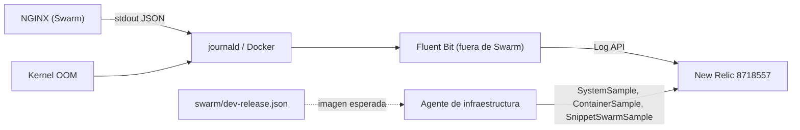

# SNI-80 — Instrumentar la VM de DEV, Swarm y el ingreso NGINX

Revisión de fuentes: 16/11/2026, infra dev `7dc6ca4`.
Estado: **en desarrollo. Diseño aprobado; nada aplicado todavía en la VM.**

Completa lo que el runtime de SNI-82 dejó pendiente
([runbook](../../observability/runtime/README.md)): logs del ingreso y del host,
fallas de tareas y OOM, versión esperada contra la que corre, pérdida de señal y
medición de costo. Sigue la [base común de SNI-79](../architecture/observability-baseline.md):
en la matriz de fallas, ingreso, VM, agente y despliegue son de Juanchi.

## Punto de partida

| Pieza | Estado al empezar | Fuente |
| --- | --- | --- |
| Agente de infraestructura | Contenedor oficial fuera de Swarm; métricas de host y contenedores; ingesta verificada en DEV el 16/11 | `observability/runtime/agent.compose.yaml`, PR #51 |
| Muestra de Swarm | `SnippetSwarmSample`: servicio, imagen, réplicas corriendo y deseadas | `observability/runtime/swarm.sh` |
| Logs | El contenedor del agente no trae forwarder: no llega ningún log | Runbook de SNI-82 |
| NGINX | Log `ingress` en texto `clave=valor` a stdout, con `$request_id`; `X-Request-ID` solo hacia el upstream | `nginx/nginx.conf`, `nginx/templates/routes.conf.template` |
| Release esperado | `swarm/dev-release.json` con imagen y digest por servicio | CD de SNI-43 |
| Licencia | Solo en `/etc/snippet-observability/dev/agent.json`, root 0600 | `scripts/start_observability_dev.py` |

## Señales nuevas

| Señal | Origen | Destino en New Relic | Para qué |
| --- | --- | --- | --- |
| Pedido de ingreso | Log JSON de NGINX | `Log` con `logtype=nginx-ingress` | Errores y latencia por ruta y upstream; correlación por `request_id` |
| OOM del kernel | journald, transporte `kernel` | `Log` con `logtype=host-kernel` | Distinguir un OOM de otra caída |
| Eventos de Docker | journald, unidad `docker.service` | `Log` con `logtype=host-docker` | Reinicios y errores del motor |
| Tareas fallidas | `swarm.sh` | `SnippetSwarmSample` (campos nuevos) | Último error, código de salida, 137 = OOM |
| Versión esperada | `swarm.sh` + release confirmado | `SnippetSwarmSample` (campos nuevos) | Detectar un deploy que no convergió |
| Pérdida de señal | Ausencia de `SystemSample` / `SnippetSwarmSample` / `Log` | Consultas NRQL | Base de las alertas de SNI-86 |

### Log de ingreso

Una línea JSON por pedido:

| Campo | Contenido |
| --- | --- |
| `request_id` | Generado por NGINX; también vuelve al cliente en `X-Request-ID` |
| `time` | ISO 8601 |
| `method`, `path` | Método y URI **sin query string** |
| `route` | `api`, `executions` o `ui` |
| `status` | Estado devuelto al cliente |
| `upstream`, `upstream_status` | Dirección y estado del upstream (varios si hubo reintento) |
| `request_time`, `upstream_connect_time`, `upstream_response_time` | Segundos |
| `bytes_sent` | Tamaño de la respuesta |

No se registran IP del cliente, `Authorization`, cookies, query string, `Referer`
ni `User-Agent`. Un `X-Request-ID` que mande el cliente se ignora: el identificador
siempre lo genera NGINX.

## Diseño

Fluent Bit corre como contenedor aparte, fuera de Swarm, igual que el agente: si el
stack cae, el forwarder sigue informando. Lee la licencia del mismo archivo que el
agente, montado en solo lectura; no hay una segunda copia ni una clave nueva.

## Decisiones

Aprobadas por Juan el 16/11/2026 («dale, aprobadas las 9»).

| # | Decisión | Alternativa descartada | Costo aceptado |
| --- | --- | --- | --- |
| O1 | Fluent Bit con la imagen oficial de New Relic, contenedor fuera de Swarm, reutilizando el archivo de licencia de la VM | Cambiar el agente a la instalación nativa con forwarder incluido | Un contenedor más que operar |
| O2 | Solo líneas de acceso de NGINX y, de journald, OOM del kernel y eventos de Docker | Todos los logs de contenedores | Los logs de las aplicaciones quedan para SNI-81 |
| O3 | Log JSON de NGINX con ruta, upstream y tiempos, sin query, IP ni credenciales; `X-Request-ID` generado y devuelto al cliente | Mantener el formato `clave=valor` y parsearlo | Cambia el formato que otros scripts podrían leer |
| O4 | `SnippetSwarmSample` suma tareas fallidas recientes, último error y código de salida; OOM del kernel por log | Un colector nuevo para tareas | Una llamada más a la API de Docker por intervalo |
| O5 | Imagen esperada desde el release confirmado contra la que corre; diagnóstico de etapa del CD documentado | Marcadores de deploy de New Relic | Los marcadores quedan como propuesta aparte |
| O6 | Consultas NRQL de pérdida de señal, sin crear alertas | Crear las alertas acá | Las alertas son de SNI-86 |
| O7 | Medición antes/después de ingesta, CPU y RAM contra el presupuesto de 10 GB/mes | Estimar sin medir | Una ventana de medición en DEV |
| O8 | PROD parametrizado, sin aplicar | Activar PROD con un flag | PROD necesita su propio inventario (SNI-88) |
| O9 | Operaciones en Azure y en la VM solo por Juan o con aprobación paso a paso | Automatizarlas desde el repo | Pasos manuales en el runbook |

## Fronteras

- SNI-79: cuenta, nombres de entidades y presupuesto.
- SNI-81: APM, trazas y logs de las aplicaciones. Este ticket deja el `request_id`
  del ingreso listo para correlacionar.
- SNI-82: el agente y el colector ya instalados; no se cambia su configuración salvo
  `swarm.sh`.
- SNI-86: dashboards, SLO y alertas sobre estas señales.
- SNI-87: ensayo de fallas.

## Privacidad y presupuesto

- Ningún log lleva IP, tokens, cookies, query string ni cuerpos.
- Los logs de journald se filtran en origen: solo OOM del kernel y la unidad de Docker.
- Límites de memoria y CPU para Fluent Bit, y buffer en disco acotado.
- Referencia de SNI-79: 10 GB/mes, con avisos a 5 y 8 GB. La medición de O7 se anota
  en este documento.

## Reversión

Pendiente: se completa con los scripts del paso 5.

## Verificación

Pendiente.
