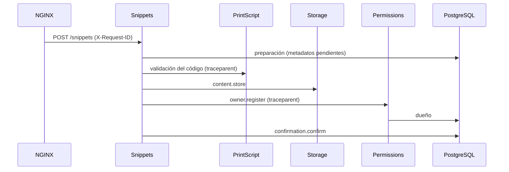

# SNI-81 — APM y Trace ID del alta de snippet

Revisión de fuentes: 17/11/2026. Snippets `9b8be24`, Permissions `356c42c`, PrintScript
`34417c3`, gradle-conventions `4a51ae0`, infra `e34c41f`.
Estado: **en desarrollo. Diseño aprobado; nada aplicado todavía.**

Instrumenta las tres JVM con APM para que un alta real por el ingreso se pueda seguir
con un único Trace ID en Snippets, PrintScript y Permissions, con logs del mismo pedido.
Continúa [SNI-80](sni-80-dev-instrumentation.md), que dejó el `X-Request-ID` de NGINX en
los logs de ingreso, y entrega a [SNI-82](sni-82-dependencies.md) las señales de JDBC y
pool que no se pueden reemplazar con conexiones SQL.

## Punto de partida

| Pieza | Estado | Consecuencia |
| --- | --- | --- |
| Framework | Spring Boot 4.1.1 (Spring 7, Tomcat 11, Jackson 3), Kotlin 2.4, Java 21, vía `jjt.spring-service` 0.2.0 | El agente de New Relic declara Spring y Tomcat «to latest» pero no nombra Spring Boot 4: se prueba antes de adoptarlo |
| Llamadas entre servicios | Snippets usa `RestClient` sobre el `HttpClient` de la JDK hacia PrintScript, Permissions y Asset; la ejecución interactiva usa el `HttpClient` directo | New Relic no instrumenta `RestClient` de Spring 7, pero sí el `HttpClient` de la JDK: ahí se propaga `traceparent` |
| Arranque | `java -jar` directo; tope de 768 MiB por servicio | El agente necesita un script de arranque y suma memoria |
| Logs | 59 llamadas a logger, sin MDC ni `X-Request-ID`, salida de texto de Spring | Faltan logs estructurados y correlación |
| Despliegue | Con el monitoreo de SNI-82 instalado, DEV rechaza reaplicar el stack completo | La activación se aplica con un deploy acotado a los tres servicios |

## Recorrido del alta

`CreateSnippet` ejecuta preparación, contenido, dueño, confirmación y lint en ese orden;
cada falla deja el alta pendiente con un `CreationFailure`. Cada tramo tiene que verse
como span propio.

## Decisiones

Aprobadas por Juan el 17/11/2026 («dale, aprobadas las 9»).

| # | Decisión | Alternativa descartada | Costo aceptado |
| --- | --- | --- | --- |
| P1 | Agente Java oficial de New Relic 9.5.0, fijado con checksum. Antes de adoptarlo, una prueba de compatibilidad con Spring Boot 4: si no hay transacciones o no se propaga `traceparent`, se replantea con OpenTelemetry | OpenTelemetry con el starter de Spring Boot 4 hacia OTLP de New Relic | Dependencia de que New Relic soporte Spring 7 sin declararlo explícitamente |
| P2 | Agente, `newrelic.yml` y script de arranque repartidos desde `gradle-conventions` 0.3.0 hacia `build/newrelic`; cada Dockerfile lo copia | Copiarlos en los tres repos | Publicar la 0.3.0 y subirla en los tres servicios |
| P3 | `NEW_RELIC_ENABLED=false` por defecto. Activado, el script exige la licencia como secreto de Swarm en `/run/secrets/newrelic_license` y falla sin ella. El secreto se crea en la VM desde `agent.json`. Nombre `snippets-service (dev)` y etiquetas `environment`, `service`, `version` | Licencia en variables del stack o en la imagen | Un secreto y un script de arranque más |
| P4 | El release registra `apm` por ambiente; el render agrega variable y secreto a los tres servicios y se aplica con un deploy acotado a ellos. Los deploys de imagen la conservan y la verificación del CD la controla | Esperar la reconciliación del manifiesto de SNI-82 | Más código en el CD |
| P5 | Instrumentación automática del agente más `@Trace` (`newrelic-api`) en preparación, storage, registro en Permissions y confirmación | Spans manuales en todo | Una dependencia chica en Snippets |
| P6 | Snippets acepta `X-Request-ID` solo con el formato de NGINX (32 hexadecimales), lo pone en el MDC y como atributo `request.id` de la transacción | Confiar en cualquier valor del header | — |
| P7 | Logs JSON con el formato estructurado de Spring Boot y reenvío por el agente con `trace.id`, `span.id` y el MDC permitido. Helper de operación, resultado y latencia para listado, alta y sharing. MDC copiado entre hilos donde hay executors | Reenviar los logs de los contenedores con Fluent Bit | Revisar las líneas de log actuales |
| P8 | 4xx como errores esperados (`expected_status_codes`) más atributo `outcome` (`invalid-code`, `denied`, `conflict`, `technical`); 5xx y dependencias caídas como errores. Sin headers ni parámetros de request, SQL ofuscado, mensajes de excepción despojados; nunca código, contenido, inputs ni tokens. IDs en trazas y logs, nunca en nombres de métricas | Ignorar los 4xx | Configuración del agente más larga |
| P9 | DEV muestrea todas las trazas para la demo, si el agente lo permite; PROD usa el muestreo adaptativo. Ingesta medida antes y después contra 10 GB/mes | Muestrear todo también en PROD | Una ventana de medición |

## Señales

| Señal | Fuente | Uso |
| --- | --- | --- |
| `Transaction` por servicio | Agente: Tomcat y Spring MVC | Latencia, throughput y errores por endpoint |
| `Span` con `trace.id` compartido | Agente: `HttpClient` de la JDK con W3C `traceparent` | Recorrido del alta entre los tres servicios |
| Spans de base de datos | Agente: JDBC de PostgreSQL | Persistencia de Snippets y Permissions, SQL ofuscado |
| Pool de conexiones | Agente: HikariCP | Lo que pide SNI-82; nombres a confirmar en DEV |
| Spans propios del alta | `@Trace` | Preparación, storage, dueño y confirmación |
| `request.id` | Filtro de Snippets | Unir el log de NGINX con la transacción |
| `outcome` | Snippets | Separar código inválido y denegaciones de errores técnicos |
| `Log` de las aplicaciones | Reenvío del agente | Logs del mismo pedido por `trace.id` |

## Privacidad

- Nunca se registran código, contenido, inputs de ejecución, bearer, contraseñas ni
  secretos, ni en logs ni en atributos.
- Sin headers ni parámetros de request en los atributos del agente.
- SQL ofuscado y mensajes de excepción despojados.
- Los IDs (`request.id`, `snippet.id`, `trace.id`) van en trazas y logs; las métricas
  usan solo dimensiones acotadas (servicio, ambiente, endpoint, resultado).

## Fronteras

- SNI-80: logs de ingreso con `request_id`; este ticket lo une con la transacción.
- SNI-82: recibe los nombres de las señales de JDBC y pool y las consultas de evidencia.
- SNI-86: dashboards y alertas sobre estas señales.
- SNI-87: ensayo de fallas con aviso real.
- SNI-88: PROD queda parametrizado y apagado.
- Trazas a través de Redis Streams quedan afuera: el alta es síncrona por HTTP; los
  workers tienen transacciones propias.

## Verificación

Pendiente. En local, sin licencia, el agente no se conecta y no genera trazas
distribuidas: ahí se verifican carga, instrumentación, logs y filtro. El Trace ID
compartido se comprueba en DEV.
